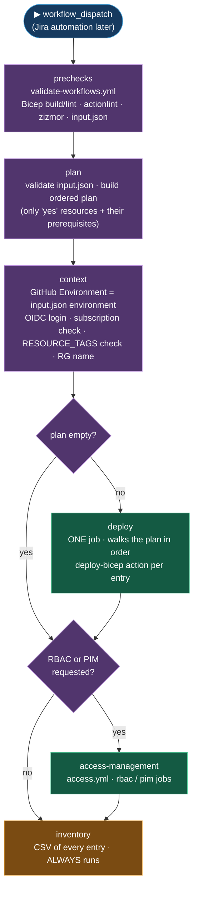
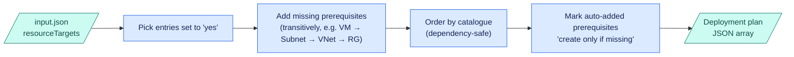
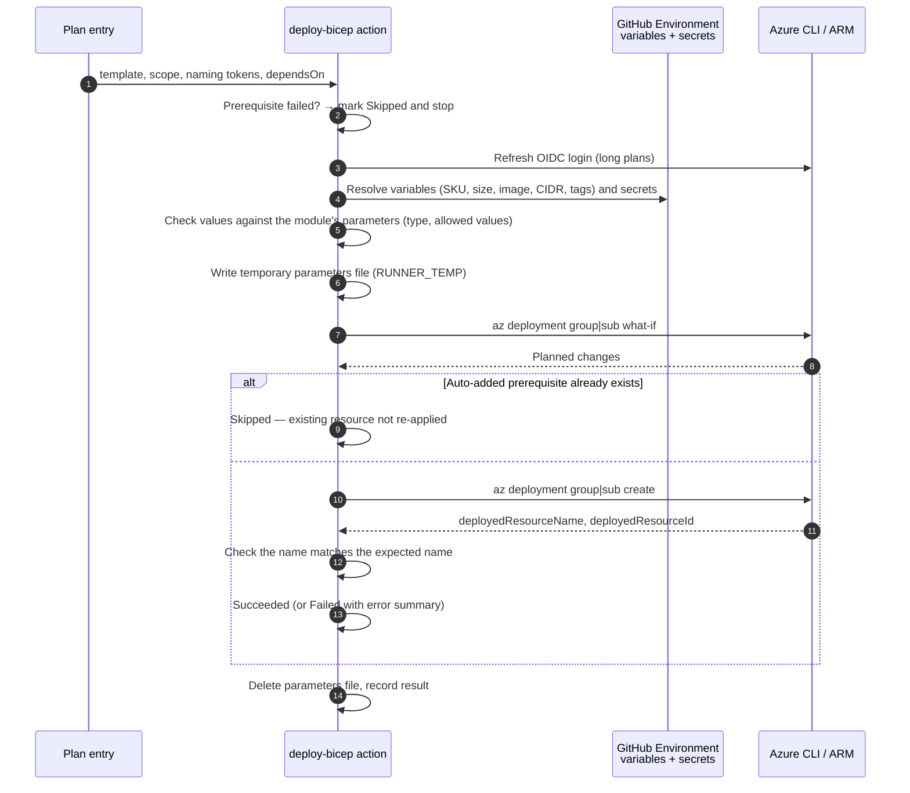
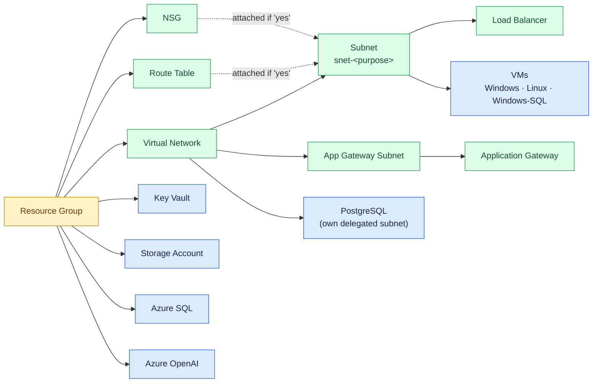
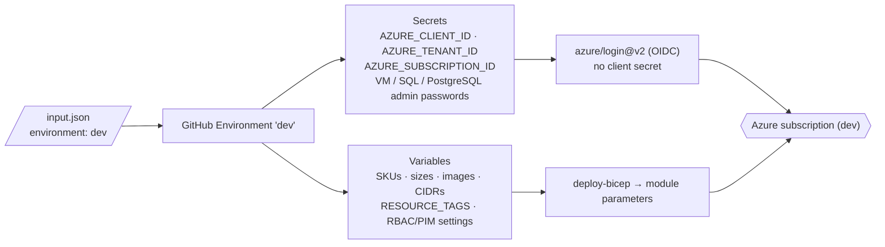

# ❄️ PIKE Infra EaaS — Azure Environment-as-a-Service Deployment


> This repository is the **deployment engine** of the PIKE Azure Environment-as-a-Service (EaaS) flow. A small `input.json` file says **which** resources to build and **where**. GitHub Actions turns that into an ordered plan and deploys it with reusable Bicep modules, one module at a time, into the Azure subscription of the selected environment.

> 📌 **Where `input.json` comes from:** `input.json` is edited by hand and committed today. In the target EaaS flow it will be **generated by Jira automation** from an approved Jira EaaS request (see [EaaS blueprint](#-eaas-blueprint--the-target-end-to-end-flow)). The Jira integration is **not built yet**. It is planned for a later phase, and nothing in this repository currently talks to Jira.

---

## 📚 Table of contents

- [🗺️ EaaS blueprint — the target end-to-end flow](#️-eaas-blueprint--the-target-end-to-end-flow)
- [🏗️ Architecture at a glance](#️-architecture-at-a-glance)
- [📁 Repository structure](#-repository-structure)
- [⚙️ Configuration with `input.json`](#️-configuration-with-inputjson)
- [🚀 How the deployment workflow works](#-how-the-deployment-workflow-works)
  - [Job sequence](#job-sequence)
  - [Building the plan](#building-the-plan)
  - [Deploying one plan entry](#deploying-one-plan-entry)
  - [Resource dependencies](#resource-dependencies)
  - [Failure handling](#failure-handling)
- [🧩 Bicep module catalogue](#-bicep-module-catalogue)
- [🔐 Authentication, secrets and variables](#-authentication-secrets-and-variables)
- [🛂 Access management (RBAC and PIM)](#-access-management-rbac-and-pim)
- [🏷️ Resource naming and tags](#️-resource-naming-and-tags)
- [📦 Artifacts produced by a run](#-artifacts-produced-by-a-run)
- [▶️ Running the workflow](#️-running-the-workflow)
- [🧭 Roadmap and current gaps](#-roadmap-and-current-gaps)
- [📖 Further documentation](#-further-documentation)

---

## 🗺️ EaaS blueprint — the target end-to-end flow

The diagram below shows the full **Azure Environment Provisioning** flow (blueprint version 2.0, with project assessment before cost analysis). This repository implements the **automation and deployment part** (green). The Jira request, assessment, approval and notification steps (grey) are outside this repository and are planned for later.

```mermaid
flowchart LR
    subgraph INTAKE["📥 Request intake — Jira (planned)"]
      direction TB
      S1["1 · Requester<br/>Dev / QA / UAT / Prod"]
      S2["2 · Jira EaaS request entry<br/>Service Management workflow"]
      S3["3 · Request parameters<br/>environment, resource type, OS,<br/>SKU, project ID, region, uptime,<br/>business information"]
      S1 --> S2 --> S3
    end

    subgraph GOVERN["🧮 Assessment and governance — Jira (planned)"]
      direction TB
      S4{"4 · Project assessment<br/>New project?"}
      S4Y["Yes → build foundation<br/>subscription, RG, VNet/subnets,<br/>NSG/route tables, DNS, Key Vault,<br/>monitoring, shared services"]
      S4N["No → use existing environment<br/>existing subscription, RG,<br/>network and shared services"]
      S5["5 · Environment standard / landing zone<br/>OS, SKU/VM sizing, security,<br/>networking, approved images"]
      S6["6 · Cost analysis<br/>estimated monthly spend"]
      S7["7 · Designated approval"]
      S8["8 · Status → Ready for deployment"]
      S4 -- "Yes" --> S4Y --> S5
      S4 -- "No" --> S4N --> S5
      S5 --> S6 --> S7 --> S8
    end

    subgraph DEPLOY["⚙️ Automation and deployment — THIS REPOSITORY"]
      direction TB
      S9["9 · Jira automation<br/>calls GitHub over HTTPS/API<br/>(planned) → today: manual run"]
      JSON[/"input.json<br/>today: edited by hand<br/>later: generated from the Jira request"/]
      S10["10 · Azure resource modules<br/>modules/*.bicep"]
      S11["11 · GitHub Actions<br/>validate → plan → deploy with Bicep"]
      S12["12 · Azure target<br/>subscription per environment,<br/>RG, VNet/subnet, region"]
      S13["13 · Mandatory tagging<br/>RESOURCE_TAGS + env/workload"]
      S14["14 · Deployment result<br/>inventory CSV artifact"]
      S9 --> JSON --> S11
      S10 --> S11 --> S12 --> S13 --> S14
    end

    subgraph CLOSE["📣 Close-out — Jira (planned)"]
      direction TB
      S15["15 · Update Jira request<br/>status and details"]
      S16["16 · Notify requester<br/>email / Jira notification"]
      S15 --> S16
    end

    MON["🛰️ Monitoring and integration (TBD)<br/>LogicMonitor — monitoring and alerting"]

    S3 --> S4
    S8 --> S9
    S14 -.->|"planned"| S15
    S12 -.->|"TBD"| MON

    classDef planned fill:#f1f5f9,stroke:#64748b,stroke-width:1.5px,color:#0f172a,stroke-dasharray: 4 3
    classDef repo fill:#dcfce7,stroke:#16a34a,stroke-width:2px,color:#14532d
    classDef input fill:#ccfbf1,stroke:#0f766e,stroke-width:2px,color:#134e4a
    classDef tbd fill:#fef3c7,stroke:#d97706,stroke-width:1.5px,color:#78350f,stroke-dasharray: 4 3
    class S1,S2,S3,S4,S4Y,S4N,S5,S6,S7,S8,S15,S16 planned
    class S9,S10,S11,S12,S13,S14 repo
    class JSON input
    class MON tbd
```



### How the blueprint maps to this repository

| Blueprint step | Status | Where it lives / what happens today |
|---|---|---|
| 1–8 Request, assessment, landing-zone standards, cost, approval | 🔜 Planned (Jira) | Not in this repository. |
| 9 Jira automation triggers the deployment | 🔜 Planned | Today a person starts **Actions → PIKE Modular Azure Infrastructure Deployment** by hand (`workflow_dispatch`). |
| Request payload → `input.json` | 🟡 Manual today | `input.json` is edited and committed by hand. **Jira automation will produce this file later**, using the same schema (see [Configuration](#️-configuration-with-inputjson)). |
| 10 List of Azure resource modules | ✅ Implemented | [modules/](modules/) holds VM, SQL, PostgreSQL, storage, networking, Key Vault, OpenAI, load balancer, application gateway, RBAC and PIM modules. |
| 11 GitHub Actions: validate, resolve config, select modules, deploy with Bicep | ✅ Implemented | [deploy.yml](.github/workflows/deploy.yml), [validate-workflows.yml](.github/workflows/validate-workflows.yml), [deploy-bicep action](.github/actions/deploy-bicep/action.yml). |
| 12 Azure target: subscription, RG, VNet/subnet, region | ✅ Implemented | Subscription = the GitHub Environment's secrets; region = `target.location`; RG `rg-<workload>-<env>` is created or re-applied. |
| 4 "Build foundation vs use existing" | 🟡 Partly | Missing prerequisites (RG, VNet, subnet) are added to the plan and created **only if they do not exist yet**. Existing ones are reused and not changed. |
| 13 Mandatory tagging | 🟡 Partly | Enforced today: `env`, `workload` (added by modules) plus `owner`, `cost-center`, `data-class` (required in `RESOURCE_TAGS`). Blueprint tags such as Project ID, Fin ID, business criticality are not enforced yet. |
| 14 Deployment result | ✅ Implemented | CSV inventory artifact with status, name and resource ID for every entry, uploaded on every run. |
| 15–16 Update Jira and notify requester | 🔜 Planned | Not in this repository. |
| Monitoring and integration (LogicMonitor) | ⏳ TBD | Not in this repository. |

---

## 🏗️ Architecture at a glance

- **Configuration:** [input.json](input.json) holds the target environment, the naming tokens, a `yes`/`no` per resource type and optional RBAC/PIM requests. No SKUs, sizes, images or CIDRs live in it.
- **Environment settings:** every setting (SKU, VM size, image, CIDR, tags, …) is a **GitHub Environment variable** in `dev`, `qa`, `uat` or `prod`. Credentials are **GitHub Environment secrets** in the same environment.
- **Orchestration:** [deploy.yml](.github/workflows/deploy.yml) validates the repository, builds an ordered plan from `input.json`, logs in to Azure with OIDC and deploys the plan.
- **Execution:** the composite action [deploy-bicep](.github/actions/deploy-bicep/action.yml) maps variables and secrets onto each module's parameters, runs **What-If**, then `az deployment … create`. It runs as Node.js through `actions/github-script` and calls the Azure CLI.
- **Infrastructure:** one Bicep module per resource type under [modules/](modules/). The modules build the resource names from the naming tokens.

### Component diagram

> Adapted from the diagram generated by [gitdiagram](https://gitdiagram.com/prometheus-n/pike-infra-eaas-new), corrected to match the code. The generated diagram showed a "PowerShell deployer". In fact, deployments run through the `deploy-bicep` composite action (`actions/github-script` + Azure CLI). `scripts/Invoke-PimRequest.ps1` is a standalone helper for local PIM testing and is **not** called by any workflow.

```mermaid
flowchart TD

subgraph group_orchestration["Deployment orchestration"]
  node_workflow["Deploy workflow<br/>[deploy.yml]"]
  node_validate["Repository validation<br/>[validate-workflows.yml]"]
  node_deployer["Bicep deployer<br/>[deploy-bicep/action.yml]"]
  node_auth["OIDC authentication<br/>[azure/login@v2]"]
  node_ghenv["GitHub Environment<br/>dev / qa / uat / prod<br/>variables + secrets"]
end

subgraph group_infrastructure["Infrastructure modules"]
  node_rg["Resource groups"]
  node_network["Networking<br/>VNet, subnet, NSG, route table,<br/>App Gateway subnet"]
  node_compute["Virtual machines<br/>[vm.bicep]"]
  node_database["Databases<br/>Azure SQL, PostgreSQL"]
  node_storage["Storage accounts"]
  node_security["Key Vault<br/>[keyvault.bicep]"]
  node_ai["Azure OpenAI<br/>[openai.bicep]"]
  node_loadbalancer["Load balancer / App Gateway<br/>[lb.bicep, applicationGateway.bicep]"]
end

subgraph group_access["Access management"]
  node_accesswf["Access workflow<br/>[access.yml]"]
  node_pim["PIM eligibility<br/>[pim.bicep]"]
  node_rbac["RBAC assignments"]
  node_pimscript["PIM request script<br/>(local testing only)"]
end

subgraph group_azure["Azure platform"]
  node_azure{{"Azure subscription"}}
  node_resources[("Azure resources")]
end

node_jira(["Jira automation<br/>(planned)"])
node_operator(("Workflow initiator"))
node_config["Deployment config<br/>[input.json]"]
node_csv[/"Inventory CSV<br/>artifact"/]

node_jira -.->|"will generate"| node_config
node_jira -.->|"will dispatch"| node_workflow
node_operator -->|"dispatches"| node_workflow
node_workflow -->|"1 · validates"| node_validate
node_config -->|"2 · builds plan"| node_workflow
node_workflow -->|"3 · authenticates"| node_auth
node_ghenv -->|"secrets"| node_auth
node_workflow -->|"4 · invokes per entry"| node_deployer
node_ghenv -->|"variables"| node_deployer
node_deployer -->|"deploys"| node_rg
node_deployer -->|"deploys"| node_network
node_deployer -->|"deploys"| node_compute
node_deployer -->|"deploys"| node_database
node_deployer -->|"deploys"| node_storage
node_deployer -->|"deploys"| node_security
node_deployer -->|"deploys"| node_ai
node_deployer -->|"deploys"| node_loadbalancer
node_workflow -->|"5 · if requested"| node_accesswf
node_accesswf -->|"deploys"| node_rbac
node_accesswf -->|"deploys"| node_pim
node_workflow -->|"6 · always"| node_csv
node_auth -->|"signs in"| node_azure
node_azure -->|"hosts"| node_resources

click node_config "https://github.com/prometheus-n/pike-infra-eaas-new/blob/feature/input.json"
click node_workflow "https://github.com/prometheus-n/pike-infra-eaas-new/blob/feature/.github/workflows/deploy.yml"
click node_validate "https://github.com/prometheus-n/pike-infra-eaas-new/blob/feature/.github/workflows/validate-workflows.yml"
click node_deployer "https://github.com/prometheus-n/pike-infra-eaas-new/blob/feature/.github/actions/deploy-bicep/action.yml"
click node_auth "https://github.com/prometheus-n/pike-infra-eaas-new/blob/feature/.github/workflows/deploy.yml"
click node_rg "https://github.com/prometheus-n/pike-infra-eaas-new/blob/feature/modules/RG/resourcegroup.bicep"
click node_network "https://github.com/prometheus-n/pike-infra-eaas-new/tree/feature/modules/networking"
click node_compute "https://github.com/prometheus-n/pike-infra-eaas-new/blob/feature/modules/compute/vm.bicep"
click node_database "https://github.com/prometheus-n/pike-infra-eaas-new/tree/feature/modules/database"
click node_storage "https://github.com/prometheus-n/pike-infra-eaas-new/blob/feature/modules/storage/storageAccount.bicep"
click node_security "https://github.com/prometheus-n/pike-infra-eaas-new/blob/feature/modules/security/keyvault.bicep"
click node_ai "https://github.com/prometheus-n/pike-infra-eaas-new/blob/feature/modules/ai/openai.bicep"
click node_loadbalancer "https://github.com/prometheus-n/pike-infra-eaas-new/blob/feature/modules/loadbalancer/lb.bicep"
click node_accesswf "https://github.com/prometheus-n/pike-infra-eaas-new/blob/feature/.github/workflows/access.yml"
click node_pim "https://github.com/prometheus-n/pike-infra-eaas-new/blob/feature/modules/access/pim/pim.bicep"
click node_pimscript "https://github.com/prometheus-n/pike-infra-eaas-new/blob/feature/scripts/Invoke-PimRequest.ps1"
click node_rbac "https://github.com/prometheus-n/pike-infra-eaas-new/tree/feature/modules/access/rbac"

classDef toneNeutral fill:#f8fafc,stroke:#334155,stroke-width:1.5px,color:#0f172a
classDef toneBlue fill:#dbeafe,stroke:#2563eb,stroke-width:1.5px,color:#172554
classDef toneAmber fill:#fef3c7,stroke:#d97706,stroke-width:1.5px,color:#78350f
classDef toneMint fill:#dcfce7,stroke:#16a34a,stroke-width:1.5px,color:#14532d
classDef toneRose fill:#ffe4e6,stroke:#e11d48,stroke-width:1.5px,color:#881337
classDef toneIndigo fill:#e0e7ff,stroke:#4f46e5,stroke-width:1.5px,color:#312e81
classDef toneTeal fill:#ccfbf1,stroke:#0f766e,stroke-width:1.5px,color:#134e4a
classDef tonePlanned fill:#f1f5f9,stroke:#64748b,stroke-width:1.5px,color:#0f172a,stroke-dasharray: 4 3
class node_workflow,node_validate,node_deployer,node_auth,node_ghenv toneBlue
class node_rg,node_network,node_compute,node_database,node_storage,node_security,node_ai,node_loadbalancer toneAmber
class node_accesswf,node_pim,node_pimscript,node_rbac toneMint
class node_azure,node_resources toneRose
class node_operator toneIndigo
class node_config,node_csv toneTeal
class node_jira tonePlanned
```



---

## 📁 Repository structure

```text
pike-infra-eaas-new/
├── .github/
│   ├── actions/
│   │   └── deploy-bicep/action.yml     # composite action: map parameters → What-If → deploy
│   └── workflows/
│       ├── deploy.yml                  # main workflow (manual dispatch)
│       ├── validate-workflows.yml      # reusable: Bicep build/lint, actionlint, zizmor, input.json checks
│       └── access.yml                  # reusable: RBAC / PIM requests
├── modules/
│   ├── RG/resourcegroup.bicep
│   ├── networking/                     # vnet, subnet, nsg, routetable, applicationGateway(+Subnet)
│   ├── loadbalancer/lb.bicep
│   ├── compute/vm.bicep                # Windows, Linux and Windows-SQL VMs
│   ├── database/                       # sql.bicep, postgresql.bicep
│   ├── storage/storageAccount.bicep
│   ├── security/keyvault.bicep
│   ├── ai/openai.bicep
│   └── access/
│       ├── rbac/                       # subscription / resource group / resource scope
│       └── pim/pim.bicep
├── scripts/Invoke-PimRequest.ps1       # local PIM testing helper (not used by workflows)
├── docs/                               # deployment guide, naming standard, variables, PIM guides
├── input.json                          # deployment request (Jira-generated in the future)
├── CLAUDE.md
└── README.md
```

---

## ⚙️ Configuration with `input.json`

`input.json` is the **deployment request**. It holds only *what* and *where*. It never holds secrets or settings (SKUs, sizes, images, CIDRs), which come from the GitHub Environment.

> 🔮 **Future source:** in the EaaS flow, Jira automation will build this file from the approved request: requester, environment, resource types and region (blueprint steps 3 and 9). The schema below is the contract that the Jira automation will need to produce. Until then, edit it by hand.

```json
{
  "environment": "dev",
  "target": {
    "workload": "platform-svc",
    "system": "sap",
    "purpose": "app",
    "location": "eastus"
  },
  "resourceTargets": {
    "resourceGroup": "yes",
    "networkSecurityGroup": "yes",
    "routeTable": "yes",
    "virtualNetwork": "yes",
    "subnet": "yes",
    "applicationGatewaySubnet": "no",
    "loadBalancer": "no",
    "applicationGateway": "no",
    "keyVault": "no",
    "storageAccount": "yes",
    "sqlDatabase": "yes",
    "openAi": "yes",
    "vmWindows": "yes",
    "vmLinux": "yes",
    "vmWindowsSql": "yes",
    "postgresql": "yes"
  },
  "accessRequests": {
    "rbac": { "request": "no", "requestorEmail": "<requestor email>" },
    "pim":  { "request": "no", "requestorEmail": "<requestor email>" }
  }
}
```

| Property | Rule (checked by the `plan` job) | Used for |
|---|---|---|
| `environment` | `dev`, `qa`, `uat` or `prod` | Selects the **GitHub Environment**, and with it the Azure subscription, variables and secrets |
| `target.workload` | `platform-svc`, `shared-infra`, `app-<name>` or `int-<system>-<entity>` | Resource group name `rg-<workload>-<env>`, tags |
| `target.system` | lowercase token, e.g. `sap`, `okta`, `fleet` | VM names |
| `target.purpose` | 2–11 lowercase letters/digits, no hyphens | Most resource names (it must also fit storage account and Key Vault limits) |
| `target.location` | Azure region name, e.g. `eastus` | Deployment region |
| `resourceTargets.<type>` | `yes` or `no` for **every** supported type; unknown keys fail | Which modules go into the plan |
| `accessRequests.rbac` / `.pim` | `request` = `yes`/`no`; valid `requestorEmail` when `yes` | Triggers [access.yml](.github/workflows/access.yml) |

Any error fails the `plan` job with a clear list of what is wrong. Nothing is deployed from an invalid file.

---

## 🚀 How the deployment workflow works

**Workflow:** [.github/workflows/deploy.yml](.github/workflows/deploy.yml) — *PIKE Modular Azure Infrastructure Deployment*
**Trigger:** manual `workflow_dispatch` (a Jira/API trigger is planned)
**Runner:** `[self-hosted, X64, Windows]`
**Permissions:** `contents: read`, `id-token: write` (OIDC)

### Job sequence



| Job | What it does |
|---|---|
| `prechecks` | Calls [validate-workflows.yml](.github/workflows/validate-workflows.yml): builds and lints every Bicep file, runs actionlint and zizmor on the workflows, checks the `input.json` structure, and uploads CSV validation reports. |
| `plan` | Reads and validates `input.json`, then builds the ordered deployment plan. The plan and the reason for each entry are written to the run summary. |
| `context` | Opens the GitHub Environment named by `input.json`, logs in with OIDC, checks the subscription, checks that `RESOURCE_TAGS` has `owner`, `cost-center` and `data-class`, and works out the resource group name `rg-<workload>-<env>`. |
| `deploy` | A **single** job that hands the plan to [deploy-bicep](.github/actions/deploy-bicep/action.yml), which deploys the entries strictly one after another. It runs only when the plan is not empty. |
| `access-management` | Runs [access.yml](.github/workflows/access.yml) when RBAC or PIM is requested. It is blocked if the resource group failed. |
| `inventory` | Writes `artifacts/deployment-inventory-<run-id>.csv` and uploads it, **even when earlier jobs failed**. |

> **Why one job and not a matrix?** A GitHub Actions matrix does not guarantee execution order, even with `max-parallel: 1`. A single job that loops over the plan guarantees that a VNet is created before its subnet and a subnet before its VM.

### Building the plan

The `plan` job contains a fixed **module catalogue** (`const CATALOG = [...]` in [deploy.yml](.github/workflows/deploy.yml)). The order of the catalogue is the deployment order, and each entry lists the prerequisites it `requires`.



**Example:** with only `"storageAccount": "yes"`, the plan is:

```text
1. Resource Group     (prerequisite of storageAccount, added automatically)
2. Storage Account    (requested in input.json)
```

Resource types set to `no` **do not appear in the run at all**. They are not shown as skipped stages.

### Deploying one plan entry

For every entry, the `deploy-bicep` action runs these steps in order:



The resource group deploys at **subscription** scope. Everything else deploys at **resource group** scope.

### Resource dependencies



Solid arrows are hard prerequisites, which are added automatically. Dotted arrows are optional links, used only when that resource is also `yes`.

| Resource (`resourceTargets` key) | Required chain (deployed in this order) | What the module looks up |
|---|---|---|
| Resource Group (`resourceGroup`) | — | — |
| NSG (`networkSecurityGroup`) | RG | — |
| Route Table (`routeTable`) | RG | — |
| Virtual Network (`virtualNetwork`) | RG | — |
| Subnet (`subnet`) | RG → VNet | `vnet-pike-<env>` |
| App Gateway Subnet (`applicationGatewaySubnet`) | RG → VNet | `vnet-pike-<env>` |
| Load Balancer (`loadBalancer`) | RG → VNet → Subnet | subnet `snet-<purpose>` |
| Application Gateway (`applicationGateway`) | RG → VNet → App Gateway Subnet | subnet `snet-<purpose>-agw` |
| VM Windows / Linux / Windows-SQL | RG → VNet → Subnet | VNet + subnet `snet-<purpose>` for the NIC |
| PostgreSQL (`postgresql`) | RG → VNet | VNet only; the module creates `snet-<purpose>-psql` |
| Key Vault, Storage, Azure SQL, OpenAI | RG | — |

**Created inside a module** (these are not separate `input.json` entries): the VM module creates its NIC `nic-<vm name>` (private IP only); the Application Gateway module creates the public IP `pip-agw-pike-<env>`; the PostgreSQL module creates a delegated subnet, a private DNS zone and a VNet link.

### Failure handling

- An **auto-added prerequisite** (one not set to `yes`) is created **only if it does not exist**. An existing one is reported as `Skipped` and left unchanged.
- The **resource group** is always applied. This is safe because it is idempotent: same name, location and tags.
- An existing **VNet** is never re-applied, so subnets created later are not removed.
- If an entry **fails**, every entry that depends on it is `Skipped`, with the failed prerequisite named. Independent entries still run.
- The run is marked **failed** if anything failed or was blocked, and the inventory CSV is still produced.

---

## 🧩 Bicep module catalogue

| Module | Resource | Notes |
|---|---|---|
| [RG/resourcegroup.bicep](modules/RG/resourcegroup.bicep) | Resource group | Subscription scope |
| [networking/nsg.bicep](modules/networking/nsg.bicep) | Network security group | Rules from `NSG_SECURITY_RULES` |
| [networking/routetable.bicep](modules/networking/routetable.bicep) | Route table | Routes from `ROUTE_TABLE_ROUTES` |
| [networking/vnet.bicep](modules/networking/vnet.bicep) | Virtual network | Never re-applied when it already exists |
| [networking/subnet.bicep](modules/networking/subnet.bicep) | Subnet | Optionally attaches the NSG / route table |
| [networking/applicationGatewaySubnet.bicep](modules/networking/applicationGatewaySubnet.bicep) | App Gateway subnet | `snet-<purpose>-agw` |
| [networking/applicationGateway.bicep](modules/networking/applicationGateway.bicep) | Application Gateway (L7) | Creates its public IP |
| [loadbalancer/lb.bicep](modules/loadbalancer/lb.bicep) | Standard Load Balancer (L4) | Private frontend in `snet-<purpose>` |
| [compute/vm.bicep](modules/compute/vm.bicep) | VM + NIC | One module for `windows`, `linux`, `windows-sql`; image from `VM_WINDOWS_IMAGE`, `VM_LINUX_IMAGE`, `VM_WINDOWS_SQL_IMAGE` |
| [database/sql.bicep](modules/database/sql.bicep) | Azure SQL server + database | Admin password from a secret |
| [database/postgresql.bicep](modules/database/postgresql.bicep) | PostgreSQL Flexible Server | VNet-integrated, private DNS |
| [storage/storageAccount.bicep](modules/storage/storageAccount.bicep) | Storage account + containers | Name without hyphens |
| [security/keyvault.bicep](modules/security/keyvault.bicep) | Key Vault | RBAC authorization, purge protection |
| [ai/openai.bicep](modules/ai/openai.bicep) | Azure OpenAI account | |
| [access/rbac/](modules/access/rbac/) | RBAC role assignment | Subscription, resource group or resource scope |
| [access/pim/pim.bicep](modules/access/pim/pim.bicep) | PIM eligible assignment | |

All modules receive their parameters from the workflow and never read `input.json` directly. They return `deployedResourceName` and `deployedResourceId`, which feed the inventory CSV. See [docs/resource-naming-standard.md](docs/resource-naming-standard.md) for all 37 resource types in the PIKE standard and which ones have a module.

---

## 🔐 Authentication, secrets and variables

Each GitHub Environment (`dev`, `qa`, `uat`, `prod`) represents **one Azure subscription**. The workflow picks the environment from `input.json` and uses only that environment's secrets and variables.



| Secret (per environment) | Purpose |
|---|---|
| `AZURE_CLIENT_ID`, `AZURE_TENANT_ID`, `AZURE_SUBSCRIPTION_ID` | OIDC login and subscription selection |
| `VM_ADMIN_PASSWORD` | VM local administrator password |
| `SQL_ADMIN_PASSWORD` | Azure SQL administrator password |
| `POSTGRESQL_ADMIN_PASSWORD` | PostgreSQL administrator password |

All non-secret variables, with their current values, are listed in [docs/github-environment-variables.md](docs/github-environment-variables.md).

**OIDC prerequisites:** a federated identity credential on the Entra application whose subject matches this repository and environment, plus enough Azure RBAC permissions to create the requested resources.

> 🔒 Never put passwords, client secrets or keys in `input.json`, Bicep files or variables. Secret values are masked in logs, and subscription IDs are redacted from resource IDs in the CSV.

---

## 🛂 Access management (RBAC and PIM)

[access.yml](.github/workflows/access.yml) is called after `deploy`, only when `accessRequests.rbac.request` or `accessRequests.pim.request` is `yes`. The requestor email comes from `input.json`. Everything else (scope, role, policy) comes from GitHub Environment variables.

| Job | Module | Notes |
|---|---|---|
| `rbac` | `RBAC_subscription.bicep`, `RBAC_resource_group.bicep` or `RBAC_resource.bicep` (picked by `RBAC_SCOPE`) | A normal, active role assignment |
| `pim` | [pim.bicep](modules/access/pim/pim.bicep) | An **eligible** assignment that is activated just-in-time. PIM is not the same as a managed identity, and it does not replace RBAC. |

The results appear as rows in the inventory CSV. See [docs/PIM/](docs/PIM/) and [modules/access/rbac/README.md](modules/access/rbac/README.md) for details.

---

## 🏷️ Resource naming and tags

Names are built **inside the modules** from the `target` tokens. They are deterministic (no instance numbers), so re-running the workflow updates the same resources instead of creating new ones. The globally unique **Key Vault, storage account and Azure OpenAI** names are all lowercase with no hyphens, and they, the **PostgreSQL** server and the **Azure SQL server** end with a stable 6-character suffix (`uniqueString` of the resource group). The `plan` job checks every name against the Microsoft length and character limits before anything is deployed.

| Resource | Pattern | Example (`purpose=app`, `system=sap`, `env=dev`) |
|---|---|---|
| Resource group | `rg-<workload>-<env>` | `rg-platform-svc-dev` |
| VNet | `vnet-pike-<env>` | `vnet-pike-dev` |
| Subnet | `snet-<purpose>` | `snet-app` |
| NSG / Route table | `nsg-pike-<purpose>-<env>` / `rt-pike-<purpose>-<env>` | `nsg-pike-app-dev` |
| VM | `vm-pike-<system>-<purpose>-<win\|lnx\|sql>-<env>` | `vm-pike-sap-app-win-dev` |
| Storage account | `stpike<purpose><env><suffix>` (lowercase, no hyphens, ≤ 24) | `stpikeappdev` + 6 chars |
| Key Vault | `kvpike<purpose><env><suffix>` (lowercase, no hyphens, ≤ 24) | `kvpikeappdev` + 6 chars |
| Azure SQL server | `sql-<workload>-<env>-<suffix>` (≤ 63) | `sql-platform-svc-dev-` + 6 chars |
| PostgreSQL | `psql-pike-<purpose>-<env>-<suffix>` (≤ 63) | `psql-pike-app-dev-` + 6 chars |
| Azure OpenAI | `oaipike<purpose><env><suffix>` (lowercase, no hyphens, ≤ 64) | `oaipikeappdev` + 6 chars |

The PIKE naming standard (all 37 resource types) is in [docs/resource-naming-standard.md](docs/resource-naming-standard.md).

**Tags:** every module adds `env` and `workload`. The `context` job fails the run unless `RESOURCE_TAGS` also contains `owner`, `cost-center` and `data-class`.

---

## 📦 Artifacts produced by a run

| Artifact | Produced by | Contents |
|---|---|---|
| `PIKE-Validation-CSV-<run-id>` | `prechecks` ([validate-workflows.yml](.github/workflows/validate-workflows.yml)) | `pike-yaml-validation.csv` (actionlint / zizmor) and `pike-bicep-validation.csv` (per Bicep file). Kept for 30 days. |
| `PIKE-Deployment-Inventory-<run-id>` | `inventory` (always runs) | `deployment-inventory-<run-id>.csv`: one row per plan entry and access request |

Inventory CSV columns: `run_id`, `timestamp_utc`, `environment`, `subscription_id` (left empty), `resource_type`, `module_name`, `resource_name`, `resource_group`, `location`, `sku`, `size_or_tier`, `image_or_runtime`, `public_access`, `deployment_status` (`Succeeded` / `Failed` / `Skipped`), `resource_id`, `error_summary`.

> In the EaaS blueprint, this CSV is the **deployment result** (step 14) that Jira automation will later read to update the ticket and notify the requester (steps 15–16).

Download artifacts from **Actions → select the run → Artifacts**.

---

## ▶️ Running the workflow

1. Edit [input.json](input.json): set `environment`, the `target` tokens and `yes`/`no` for each resource. (Later, Jira automation will generate this file.)
2. Check that the matching GitHub Environment has its secrets and variables. See [docs/github-environment-variables.md](docs/github-environment-variables.md).
3. Make sure the Windows self-hosted runner is online and has the Azure CLI installed.
4. Go to **Actions → PIKE Modular Azure Infrastructure Deployment → Run workflow** and pick the branch.
5. Check the **plan** summary to see what will be deployed and why.
6. Follow the What-If output and the result of each entry in the `deploy` job.
7. Download the inventory CSV and verify the resources in Azure.

---

## 🧭 Roadmap and current gaps

| Area | Today | Next |
|---|---|---|
| Request source | `input.json` edited by hand | **Jira automation generates `input.json`** from the approved EaaS request |
| Trigger | Manual `workflow_dispatch` | Jira automation calls GitHub over HTTPS/API when the request status is *Ready for Deployment* |
| Project assessment, cost analysis, approval | — | Done in Jira before triggering (blueprint steps 4–8) |
| Feedback to the requester | Inventory CSV artifact only | Jira ticket updated with status and resource details; requester notified (steps 15–16) |
| Mandatory tags | `env`, `workload`, `owner`, `cost-center`, `data-class` | Add the blueprint tags: Application, Project ID, Fin ID, Business Unit, Business Criticality |
| Monitoring | — | LogicMonitor integration (TBD) |
| Region / SKU availability | The `deploy` job checks VM and PostgreSQL SKUs against the selected subscription at run time. `auto` picks the lowest-cost available SKU; explicit SKUs are checked before deployment ([.github/scripts/select-skus.js](.github/scripts/select-skus.js)) | Add the same check for Azure OpenAI |
| Multiple instances of one type | One instance per resource type per run | Extend the schema only if needed, keeping it backward-compatible |
| Resource types | 16 deployable types (see [naming standard](docs/resource-naming-standard.md) for the 37 in the standard) | Add modules only when approved |

---

## 📖 Further documentation

- [docs/DEPLOYMENT-GUIDE.md](docs/DEPLOYMENT-GUIDE.md) — step-by-step deployment guide
- [docs/workflows/deploy.md](docs/workflows/deploy.md) — workflow internals
- [docs/github-environment-variables.md](docs/github-environment-variables.md) — every variable and secret, per environment
- [docs/resource-naming-standard.md](docs/resource-naming-standard.md) — PIKE naming standard (37 resource types)
- [docs/PIM/](docs/PIM/) — PIM guides
- [CLAUDE.md](CLAUDE.md) — repository standards

**Module READMEs** (resource explanation, dependencies, parameters, SKUs):

| Module | README |
|---|---|
| Resource group | [modules/RG/README.md](modules/RG/README.md) |
| Networking (VNet, subnet, NSG, route table, App Gateway + subnet) | [modules/networking/README.md](modules/networking/README.md) |
| Load balancer | [modules/loadbalancer/README.md](modules/loadbalancer/README.md) |
| Virtual machines (Windows, Linux, Windows-SQL) — **SKU / disk availability** | [modules/compute/README.md](modules/compute/README.md) |
| PostgreSQL Flexible Server — **SKU availability, region note** | [modules/database/README-postgresql.md](modules/database/README-postgresql.md) |
| Azure SQL | [modules/database/README-sql.md](modules/database/README-sql.md) |
| Storage account | [modules/storage/README.md](modules/storage/README.md) |
| Key Vault | [modules/security/README.md](modules/security/README.md) |
| Azure OpenAI — **SKU / region availability** | [modules/ai/README.md](modules/ai/README.md) |
| RBAC | [modules/access/rbac/README.md](modules/access/rbac/README.md) |
| PIM | [modules/access/pim/README.md](modules/access/pim/README.md) |

---

<p align="center">
  <b>❄️ PIKE Infra EaaS | Azure Environment-as-a-Service</b>
  <br/>
  <sub>Jira-driven (planned) • Configuration-driven • Modular Bicep • OIDC-authenticated • Sequential and dependency-safe</sub>
</p>
