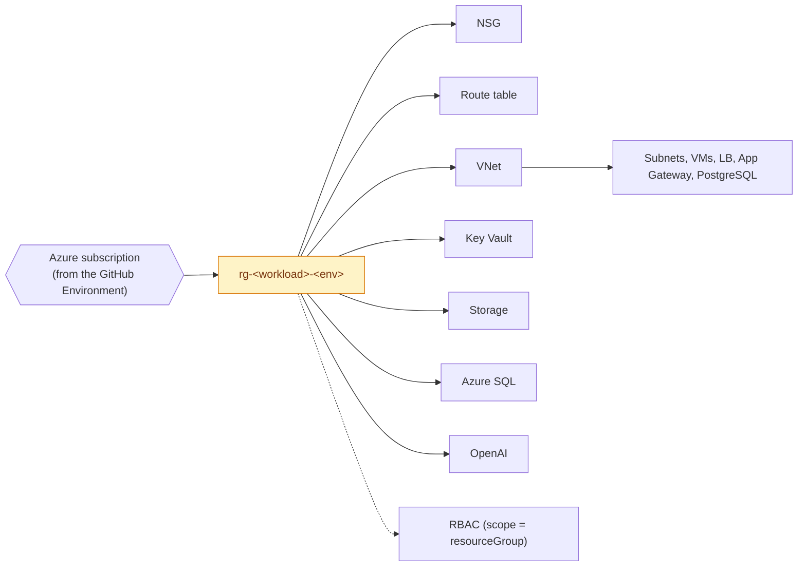

# 📦 Resource Group module — `resourcegroup.bicep`

Creates the **Azure resource group** that holds every other resource in a deployment. It is the first entry in every deployment plan.

| | |
|---|---|
| **File** | [resourcegroup.bicep](resourcegroup.bicep) |
| **Azure resource** | `Microsoft.Resources/resourceGroups@2021-04-01` |
| **Deployment scope** | **Subscription** (`targetScope = 'subscription'`, deployed with `az deployment sub`) |
| **`input.json` key** | `resourceTargets.resourceGroup` |
| **Name** | `rg-<workload>-<env>` → e.g. `rg-platform-svc-dev` |

---

## What is a resource group?

A resource group is a logical container in an Azure subscription. Resources inside it share a lifecycle, access control (RBAC can be granted on the whole group) and a region for the group's metadata. Deleting the group deletes everything inside it.

---

## Dependencies

| Direction | Resource | Notes |
|---|---|---|
| **Needs** | Azure subscription | Selected by the `AZURE_SUBSCRIPTION_ID` secret of the GitHub Environment |
| **Needed by** | **Every** other module | The workflow adds the resource group to the plan automatically whenever anything else is `yes` |
| **Needed by** | RBAC with `RBAC_SCOPE=resourceGroup` or `storageAccount` | The access job is blocked if the resource group failed |

**Behaviour in the workflow:** the resource group is **always applied**, even when it already exists. This is safe because the deployment is idempotent: same name, location and tags. The `context` job works out the same name independently, and the deploy action fails if the name the module produces does not match.

---

## Parameters

| Parameter | Type | Source | Description |
|---|---|---|---|
| `environmentName` | string (`dev`/`qa`/`uat`/`prod`) | `input.json` → `environment` | Environment token |
| `workload` | string (3–60) | `input.json` → `target.workload` | `platform-svc`, `shared-infra`, `app-<name>` or `int-<system>-<entity>` |
| `location` | string | `input.json` → `target.location` | Azure region, e.g. `eastus` |
| `tags` | object | GitHub variable `RESOURCE_TAGS` | Must contain `owner`, `cost-center`, `data-class`; the module adds `env` and `workload` |

## Outputs

| Output | Description |
|---|---|
| `deployedResourceId` | Full resource ID of the resource group |
| `deployedResourceName` | `rg-<workload>-<env>` |

---

## Notes

- Changing `target.workload` or `environment` produces a **different** resource group name, and therefore a new resource group. Existing resources are not moved.
- The region of the resource group only stores its metadata. Each resource can still choose its own region (see the PostgreSQL module, which has a fixed region).
