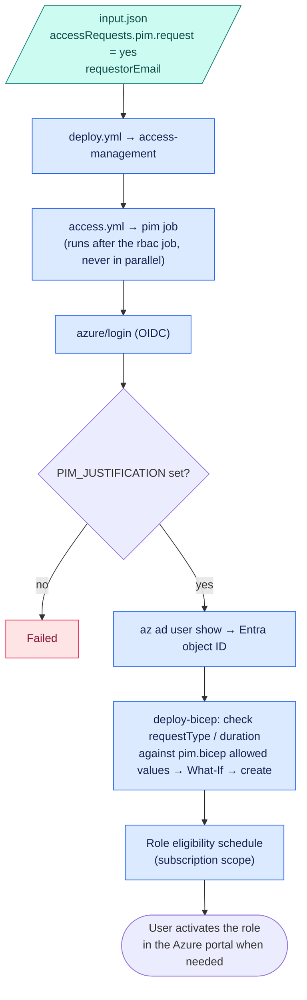

# 🛡️ PIM module — `pim.bicep`

Submits an **Azure resource PIM eligibility request**. It makes a Microsoft Entra **user eligible** for an Azure role at **subscription** scope for a limited time. The user must then *activate* the role (just-in-time) when they need it.

| | |
|---|---|
| **File** | [pim.bicep](pim.bicep) |
| **Azure resource** | `Microsoft.Authorization/roleEligibilityScheduleRequests@2024-09-01-preview` |
| **Deployment scope** | **Subscription** (`az deployment sub`) |
| **`input.json` key** | `accessRequests.pim` → `{ "request": "yes", "requestorEmail": "<user email>" }` |
| **Name** | A GUID: `guid(subscription().id, principalId, roleDefinitionId, startDateTime)` |

---

## What is PIM?

Privileged Identity Management (PIM) controls **privileged access**:

| | RBAC ([../rbac](../rbac/README.md)) | PIM (this module) |
|---|---|---|
| Access type | **Active**: always on | **Eligible**: the user must activate it |
| Duration | Permanent until removed | Eligibility expires after `duration`; each activation is time-boxed |
| Approval / MFA / justification | No | Configurable per role, in the PIM role settings |

PIM is **not** a managed identity, and it does not replace RBAC. It governs *when* a role assignment becomes active.

---

## How a request flows



---

## Dependencies

| Needs | Notes |
|---|---|
| Subscription (GitHub Environment) | Scope of the eligibility |
| Entra **user** in `requestorEmail` | Resolved with `az ad user show`; only users are supported |
| Workflow identity permissions | Must be allowed to create role eligibility schedule requests at subscription scope (e.g. *User Access Administrator* / *Owner*), plus Microsoft Graph user read |
| Microsoft Entra ID P2 (or Governance) licence | Required for PIM |

PIM does **not** depend on any resource from the deployment plan.

---

## Parameters

| Parameter | Source | Description |
|---|---|---|
| `principalId` | Computed: object ID of `requestorEmail` | |
| `roleDefinitionGuid` | `PIM_READER_ROLE_DEFINITION_ID` | Role GUID (proposed default: Reader `acdd72a7-3385-48ef-bd42-f606fba81ae7`) |
| `requestType` | `PIM_REQUEST_TYPE` | `AdminAssign` (new), `AdminUpdate`, `AdminRemove`, `AdminExtend`, `AdminRenew` |
| `duration` | `PIM_MAX_DURATION` | ISO 8601 duration from the module's allowed list: `PT1H` … `PT24H`, `P1D` … `P365D`, `P1W` … `P4W`, `P1M` … `P12M`, `P1Y`, `P2Y` |
| `justification` | `PIM_JUSTIFICATION` | Required; the job fails if it is empty |
| `requestPolicyValidated` | Set to `true` by the workflow | Guardrail: `@allowed([true])`, so a direct deployment without it is rejected |
| `startDateTime` | Default `utcNow()` | Start of the eligibility |
| `azureResourcePimPolicy`, `entraRolePimPolicy`, `groupPimPolicy`, `pimAssignmentDefaults` | Default `{}` | Accepted for traceability only; **not applied** to Azure |

## Outputs

| Output | Description |
|---|---|
| `deployedResourceId` / `deployedResourceName` | Request ID and GUID name (written to the inventory CSV) |
| `eligibilityRequestId` / `eligibilityRequestName` | Same values |

---

## Files in this directory

| File | Status |
|---|---|
| [pim.bicep](pim.bicep) | ✅ Used by `access.yml` |
| [pim-policy-settings.bicepparam](pim-policy-settings.bicepparam) | 📝 Policy *intent* (Owner / User Access Administrator, Entra roles, PIM for Groups). **Not used by the workflow** and not written to Azure. |
| [pim.json](pim.json) | ⚠️ An older compiled ARM template. Its parameters (e.g. `roleDefinitionId`) no longer match `pim.bicep` (`roleDefinitionGuid`). The workflow deploys the `.bicep` file, not this one. |

---

## Behaviour notes

- **Not idempotent:** the request name includes `startDateTime` (`utcNow()`), so every run submits a **new** request. Submitting `AdminAssign` for a user who is already eligible for the same role and scope fails with `RoleAssignmentExists`. Use `AdminExtend` or `AdminRenew` for that case.
- **Role settings** (activation duration, MFA, approval, ticket info) are **not** configured by this module. They come from the PIM settings of the role in the subscription.
- The comments in `pim.bicep` mention a "PowerShell runner" that validates the policy. In the current workflow, `access.yml` sets `requestPolicyValidated=true` itself, after checking the justification and the allowed values. No PowerShell is run.

## Manual test

```bash
az deployment sub what-if --location eastus \
  --template-file modules/access/pim/pim.bicep \
  --parameters principalId=<OBJECT_ID> roleDefinitionGuid=acdd72a7-3385-48ef-bd42-f606fba81ae7 \
               requestType=AdminAssign duration=P90D justification="<reason>" requestPolicyValidated=true
```

More guides: [docs/PIM/](../../../docs/PIM/).
