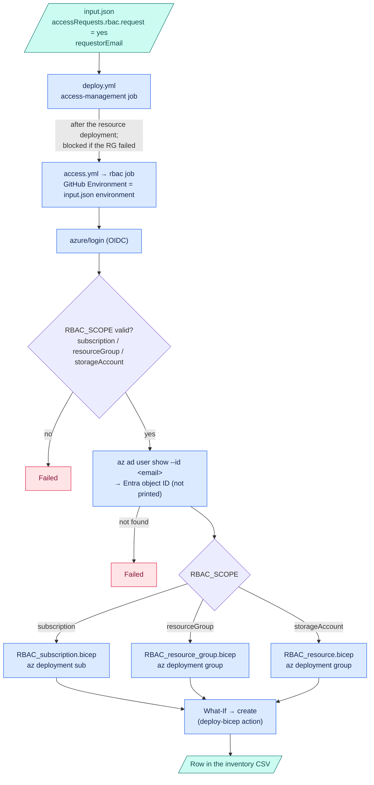

# 🔐 RBAC modules — Azure role assignments

Three Bicep templates that grant an **Azure RBAC role** to a Microsoft Entra **user** at one of three scopes. One template is used per run, chosen by the `RBAC_SCOPE` GitHub Environment variable.

| `RBAC_SCOPE` | Template | Deployment scope | Role is granted on |
|---|---|---|---|
| `subscription` | [RBAC_subscription.bicep](RBAC_subscription.bicep) | Subscription (`az deployment sub`) | The whole subscription of the GitHub Environment |
| `resourceGroup` | [RBAC_resource_group.bicep](RBAC_resource_group.bicep) | Resource group (`az deployment group`) | `rg-<workload>-<env>` |
| `storageAccount` | [RBAC_resource.bicep](RBAC_resource.bicep) | Resource group | One storage account (`RBAC_STORAGE_ACCOUNT_NAME`) in `rg-<workload>-<env>` |

**Azure resource:** `Microsoft.Authorization/roleAssignments@2022-04-01`
**`input.json` key:** `accessRequests.rbac` → `{ "request": "yes", "requestorEmail": "<user email>" }`

---

## What is an RBAC role assignment?

Azure role-based access control (RBAC) grants access by attaching three things together:

| Part | In this repository |
|---|---|
| **Who** (security principal) | The Entra user in `requestorEmail` (resolved to an object ID) |
| **What** (role definition) | `RBAC_READER_ROLE_DEFINITION_ID`, by default the built-in **Reader** `acdd72a7-3385-48ef-bd42-f606fba81ae7` |
| **Where** (scope) | Subscription, resource group or storage account (`RBAC_SCOPE`) |

The assignment is **active and permanent** until it is removed. For time-bound, approve-on-activation access, use **PIM** instead ([../pim/README.md](../pim/README.md)). RBAC and PIM are separate: PIM does not replace RBAC, and neither is a managed identity.

---

## How a request flows



---

## Dependencies

| `RBAC_SCOPE` | Must already exist | How to make sure |
|---|---|---|
| `subscription` | The subscription (GitHub Environment) | Always true |
| `resourceGroup` | `rg-<workload>-<env>` | Set `resourceGroup: "yes"` in the same run, or create it earlier |
| `storageAccount` | `rg-<workload>-<env>` **and** the storage account `RBAC_STORAGE_ACCOUNT_NAME` | Set `storageAccount: "yes"` in the same run, or create it earlier. The template looks it up as `existing`. |
| All scopes | The Entra **user** in `requestorEmail` | The workflow only resolves **users** (`az ad user show`); groups and service principals are not supported by the workflow |

Access requests are **not** added to the deployment plan automatically. The `access-management` job runs after `deploy`, and is skipped if the resource group entry failed.

### Permissions needed by the workflow identity

- `Microsoft.Authorization/roleAssignments/write` at the target scope (for example *User Access Administrator*, *Role Based Access Control Administrator* or *Owner*).
- Microsoft Graph **directory read** (e.g. `User.Read.All`) to resolve the email to an object ID.

---

## Parameters

### Common to all three templates

| Parameter | Source | Description |
|---|---|---|
| `principalId` | Computed: object ID of `requestorEmail` | Never printed in logs |
| `roleDefinitionGuid` | `RBAC_READER_ROLE_DEFINITION_ID` | Role GUID; the template builds the full ID with `subscriptionResourceId()` |
| `principalType` | Fixed `User` by the workflow | Templates also allow `Group` and `ServicePrincipal` |

### Template-specific

| Template | Extra parameter | Source |
|---|---|---|
| `RBAC_subscription.bicep` | `assignmentSeed` (optional) | Not set by the workflow (default `''`) |
| `RBAC_resource.bicep` | `storageAccountName` | `RBAC_STORAGE_ACCOUNT_NAME` |
| `RBAC_resource_group.bicep` | — | The target RG is the deployment's resource group |

### GitHub Environment variables

| Variable | `dev` value | Required |
|---|---|---|
| `RBAC_SCOPE` | `resourceGroup` | Yes |
| `RBAC_READER_ROLE_DEFINITION_ID` | `acdd72a7-3385-48ef-bd42-f606fba81ae7` (Reader) | Yes |
| `RBAC_STORAGE_ACCOUNT_NAME` | — | Only when `RBAC_SCOPE = storageAccount` |

---

## Assignment name and idempotency

Role assignment names must be GUIDs. Each template builds a **deterministic** GUID:

| Template | Name |
|---|---|
| Subscription | `guid(subscription().id, principalId, roleDefinitionId[, assignmentSeed])` |
| Resource group | `guid(resourceGroup().id, principalId, roleDefinitionId)` |
| Storage account | `guid(storageAccount.id, principalId, roleDefinitionId)` |

Re-running the same request produces the **same** assignment name, so a second run is a no-op rather than a duplicate. If the same user/role/scope was assigned earlier **outside** this workflow (with a different name), Azure returns `RoleAssignmentExists`.

---

## Outputs

| Output | Templates | Description |
|---|---|---|
| `deployedResourceId` / `deployedResourceName` | all | Role assignment ID and GUID name (written to the inventory CSV) |
| `roleAssignmentId` | all | Same as `deployedResourceId` |
| `assignedResourceGroupId` | resource group | The RG that received the role |
| `assignedResourceId` | storage account | The storage account that received the role |

---

## Manual test

```bash
# Resource-group scope (Reader)
az deployment group what-if \
  --resource-group rg-platform-svc-dev \
  --template-file modules/access/rbac/RBAC_resource_group.bicep \
  --parameters principalId=<OBJECT_ID> roleDefinitionGuid=acdd72a7-3385-48ef-bd42-f606fba81ae7 principalType=User

# Subscription scope
az deployment sub what-if --location eastus \
  --template-file modules/access/rbac/RBAC_subscription.bicep \
  --parameters principalId=<OBJECT_ID> roleDefinitionGuid=acdd72a7-3385-48ef-bd42-f606fba81ae7
```

---

## Limitations

- One role, one user and one scope per run.
- `RBAC_resource.bicep` supports **Storage Accounts only**. Other resource types would need their own typed `existing` reference.
- Only users are resolved by the workflow. Groups and service principals are not.
- Removing access is not automated. Delete the role assignment manually.
