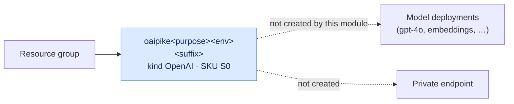

# 🤖 Azure OpenAI module — `openai.bicep`

Creates an **Azure OpenAI account** (a Cognitive Services account of kind `OpenAI`) with a custom subdomain.

| | |
|---|---|
| **File** | [openai.bicep](openai.bicep) |
| **Azure resource** | `Microsoft.CognitiveServices/accounts@2023-05-01`, `kind: OpenAI` |
| **Deployment scope** | Resource group |
| **`input.json` key** | `resourceTargets.openAi` |
| **Name** | `oaipike<purpose><env><suffix>` → e.g. `oaipikeappdev` + 6 characters (all lowercase, no hyphens). See [Naming rules](#naming-rules) |
| **Endpoint** | `https://<name>.openai.azure.com/` (the custom subdomain uses the same name) |

---

## What is Azure OpenAI?

Azure OpenAI hosts OpenAI models (GPT, embeddings, …) inside Azure, with Entra authentication, private networking and regional data residency. The **account** created here is the container. Models only become usable after a **model deployment** (`Microsoft.CognitiveServices/accounts/deployments`) is created inside it.

> ℹ️ This module creates **only the account**. It deploys **no models**: no `AZURE_OPENAI_MODEL`, version or capacity is used. Models must be deployed separately, within the region's model availability and the subscription's quota.

---

## Dependencies



| Direction | Resource | Notes |
|---|---|---|
| **Needs** | Resource group | No network dependency |
| **Needs (subscription)** | Access to Azure OpenAI in the region | The subscription must be allowed to create `OpenAI` accounts in `target.location` |
| **Not created** | Model deployments, private endpoint, role assignments | |

---

## Naming rules

| Rule | Microsoft limit | Pike name |
|---|---|---|
| Account name (`Microsoft.CognitiveServices/accounts`) | Unique in the resource group · **2–64** characters · alphanumerics and hyphens · start and end with an alphanumeric | ✅ |
| Custom subdomain (`customSubDomainName`) | **Unique across Azure** (it is the endpoint host name) · **2–64** characters · alphanumerics and hyphens · cannot end with a hyphen · **cannot be changed after creation** | ✅ same value as the account name |
| Pike convention | All **lowercase**, **no spaces**, **no hyphens** | ✅ |

The name is `oaipike` + `purpose` + `env` + a **6-character suffix**, where `<suffix>` = first characters of `uniqueString(resourceGuid)`, where `resourceGuid` = `guid(<resource group ID>, 'Microsoft.CognitiveServices/accounts')` is the globally defined GUID declared in the module:

- **Unique:** the suffix is different for every subscription and resource group, so two environments or two clients can never ask for the same subdomain.
- **Stable:** the suffix is deterministic. Re-running the workflow in the same resource group produces the same name, so the existing account is updated and no duplicate is created.
- **Always valid:** the module lower-cases the name and strips spaces, `-`, `_` and `.`. Length: `oaipike` (7) + purpose (2–11) + env (2–4) + suffix (6) = **17–28** characters, well under 64.

The exact name is printed in the run summary and in the inventory CSV (`deployedResourceName`).

> 🔁 A deleted account is **soft-deleted for 48 hours** and its name cannot be reused in that time. Because the suffix is stable, re-creating the account in the same resource group needs the deleted one to be purged first (`az cognitiveservices account purge`).

---

## Parameters

| Parameter | Source | `dev` value | Description |
|---|---|---|---|
| `skuName` | `AZURE_OPENAI_SKU` | `S0` | Account SKU |
| `publicNetworkAccess` | `AZURE_OPENAI_PUBLIC_NETWORK_ACCESS` | `Enabled` | `Enabled` / `Disabled` |
| `environmentName`, `workload`, `purpose`, `location`, `tags` | `input.json` / `RESOURCE_TAGS` | | `location` = `target.location` |

## Outputs

| Output | Description |
|---|---|
| `deployedResourceId` | Account resource ID |
| `deployedResourceName` | `oaipike<purpose><env><suffix>` |
| `resourceGuid` | Globally defined GUID (`guid(<resource group ID>, <resource type>)`) the name suffix is derived from |
| `endpoint` | The account endpoint URL |

---

## 📋 SKU details and region availability

### Account SKU

| SKU | Status | Notes |
|---|---|---|
| `S0` | ✅ Configured | The standard (and in practice the only) SKU for `kind: OpenAI` accounts. Billing is per token or per provisioned throughput on the **model deployments**, not on the account. |

### ⚠️ Known issue: deployment problems in `eastus`

The team hit **availability problems when deploying Azure OpenAI in `eastus`** (`target.location`). The cause is **region and subscription capacity**, not the template. Typical symptoms:

| Error you may see | Meaning | What to do |
|---|---|---|
| `InsufficientQuota` / quota exceeded | The subscription has no free quota for this resource or model in the region | Request quota, or use another region |
| `SkuNotAvailable` / `LocationNotAvailableForResourceType` | `OpenAI` accounts (or the SKU) are not offered to this subscription in the region | Choose a region where the `S0` SKU is listed (see the commands below) |
| `CustomDomainInUse` / subdomain already taken | The custom subdomain is unique across Azure and is still held by a soft-deleted account from an earlier run in the same resource group | Purge the soft-deleted account (`az cognitiveservices account purge`) |
| Model not available (when deploying models later) | Model availability differs **per region and per model version** | Check model availability for the region before choosing it |

> 🔁 A deleted Cognitive Services account is **soft-deleted** and keeps its name reserved. Purge it (`az cognitiveservices account purge`) before you re-create the same name.

### How to check availability before deploying

Run these against the target subscription (read-only):

```bash
# Is the OpenAI account SKU offered to this subscription in the region?
az cognitiveservices account list-skus --kind OpenAI --location eastus -o table

# Which models and versions can be deployed in the region? (needs a recent Azure CLI)
az cognitiveservices model list --location eastus -o table

# Current quota usage in the region (needs a recent Azure CLI)
az cognitiveservices usage list --location eastus -o table

# Soft-deleted accounts that still hold a name
az cognitiveservices account list-deleted -o table
```

If `eastus` is not possible, the region is set for **every** resource through `input.json` → `target.location`. This module has no separate region setting, so moving only OpenAI to another region would need a module/workflow change.
