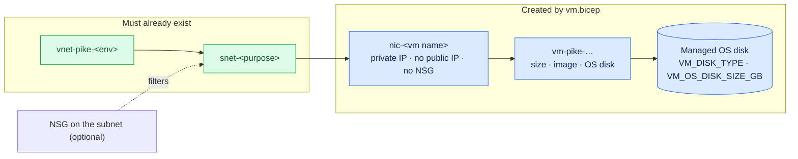

# 🖥️ Virtual Machine module — `vm.bicep`

One module that creates the three VM types offered by the EaaS flow: **Windows**, **Linux** and **Windows with SQL Server**. Each VM gets its own network interface (private IP only).

| | |
|---|---|
| **File** | [vm.bicep](vm.bicep) |
| **Azure resources** | `Microsoft.Compute/virtualMachines@2024-03-01`, `Microsoft.Network/networkInterfaces@2023-09-01` |
| **Deployment scope** | Resource group |
| **`input.json` keys** | `resourceTargets.vmWindows`, `resourceTargets.vmLinux`, `resourceTargets.vmWindowsSql` |

| VM type (`vmType`) | `input.json` key | VM name | Computer (host) name |
|---|---|---|---|
| `windows` | `vmWindows` | `vm-pike-<system>-<purpose>-win-<env>` | first 15 chars of `<system><purpose>win<env>` |
| `linux` | `vmLinux` | `vm-pike-<system>-<purpose>-lnx-<env>` | same as the VM name |
| `windows-sql` | `vmWindowsSql` | `vm-pike-<system>-<purpose>-sql-<env>` | first 15 chars of `<system><purpose>sql<env>` |

Example (`system=sap`, `purpose=app`, `dev`): `vm-pike-sap-app-win-dev` / computer name `sapappwindev`. The NIC is `nic-<vm name>`.

> Windows computer names are limited to **15 characters** (NetBIOS), so the module builds a short host name separately from the Azure resource name.

---

## What does the module create?



| Direction | Resource | Notes |
|---|---|---|
| **Needs** | VNet `vnet-pike-<env>` and subnet `snet-<purpose>` | Looked up as `existing`. The plan adds RG → VNet → Subnet automatically when a VM is `yes`. |
| **Optional** | NSG on the subnet | The NIC has **no NSG of its own**. Set `networkSecurityGroup: "yes"` to protect the VM. |
| **Creates** | NIC, VM, managed OS disk | No public IP, no data disks, no extensions |
| **Secret** | `VM_ADMIN_PASSWORD` | Same password secret for all three VM types |

The three VM types are separate plan entries (in the order Windows → Linux → Windows-SQL) and deploy **one after another**. They share the subnet but have independent names, so all three can be `yes` at once.

---

## Parameters

| Parameter | Source | Description |
|---|---|---|
| `vmType` | computed by the workflow | `windows`, `linux`, `windows-sql` |
| `environmentName`, `systemName`, `purpose`, `workload`, `location` | `input.json` → `environment`, `target.*` | Naming, tags, region |
| `imageReference` | `VM_WINDOWS_IMAGE` / `VM_LINUX_IMAGE` / `VM_WINDOWS_SQL_IMAGE` | `publisher:offer:sku:version` |
| `vmSize` | `VM_WINDOWS_SIZE` / `VM_LINUX_SIZE` / `VM_WINDOWS_SQL_SIZE` | e.g. `Standard_D2as_v5` |
| `adminUsername` | `VM_ADMIN_USERNAME` | Shared by all VM types (`azureadmin` in `dev`) |
| `vmAdminPassword` | **secret** `VM_ADMIN_PASSWORD` | `@secure()`; Linux VMs also use password login (`disablePasswordAuthentication: false`) |
| `privateIpAllocationMethod` | `VM_PRIVATE_IP_ALLOCATION_METHOD` | `Dynamic` / `Static` |
| `osDiskStorageAccountType` | `VM_DISK_TYPE` | e.g. `StandardSSD_LRS` |
| `osDiskSizeGB` | `VM_OS_DISK_SIZE_GB` | `0` = image default |
| `enableBootDiagnostics` | `VM_BOOT_DIAGNOSTICS_ENABLED` | Uses managed boot-diagnostics storage |
| `tags` | `RESOURCE_TAGS` | |

## Outputs

| Output | Description |
|---|---|
| `deployedResourceId` / `deployedResourceName` | VM ID and name |
| `computerName` | The OS host name |
| `networkInterfaceId` | NIC resource ID |

---

## 📋 SKU, image and disk details

### Currently configured (`dev` GitHub Environment)

| Setting | Windows (`vmWindows`) | Linux (`vmLinux`) | Windows + SQL (`vmWindowsSql`) |
|---|---|---|---|
| Image variable | `VM_WINDOWS_IMAGE` | `VM_LINUX_IMAGE` | `VM_WINDOWS_SQL_IMAGE` |
| Image value | *owner to provide* | *owner to provide* | `MicrosoftSQLServer:SQL2022-WS2022:sqldev-gen2:latest` |
| Size variable | `VM_WINDOWS_SIZE` | `VM_LINUX_SIZE` | `VM_WINDOWS_SQL_SIZE` |
| Size value | *owner to provide* | *owner to provide* | `Standard_D2as_v5` |
| OS disk type (shared) | `StandardSSD_LRS` | `StandardSSD_LRS` | `StandardSSD_LRS` |
| OS disk size (shared) | `128` GB | `128` GB | `128` GB |

Source: [docs/github-environment-variables.md](../../docs/github-environment-variables.md).

### OS disk types the module accepts (`VM_DISK_TYPE`)

| Value | Disk | Notes |
|---|---|---|
| `Standard_LRS` | Standard HDD | Cheapest; dev/test only |
| `StandardSSD_LRS` | Standard SSD | **Current value**; works with every VM size |
| `StandardSSD_ZRS` | Standard SSD, zone-redundant | Only in regions with availability zones |
| `Premium_LRS` | Premium SSD | **Only with premium-storage-capable sizes**: sizes with an `s` in the name, e.g. `D2s_v5`, `D2as_v5`, `B2ms` (not `D2a_v4`, `D2_v5`) |
| `Premium_ZRS` | Premium SSD, zone-redundant | Same size rule as `Premium_LRS`; zone regions only |
| `PremiumV2_LRS` / `UltraSSD_LRS` | Premium SSD v2 / Ultra | ❌ **Not supported as an OS disk** |

### OS disk size rules (`VM_OS_DISK_SIZE_GB`)

- The size must be **≥ the image's own disk size**. Typical defaults are about **127 GB for Windows / Windows-SQL images** and **30 GB for most Linux images**. `0` uses the image default.
- An OS disk **cannot be shrunk** after creation. It can only grow while the VM is deallocated.
- Billing is by disk tier, e.g. `128` GB = E10 (Standard SSD) / P10 (Premium SSD).
- The maximum OS disk size is 4,095 GB.

### Example sizes (verify each one in the region first)

| Family | Example sizes | vCPU / RAM | Typical use | Premium disk |
|---|---|---|---|---|
| B-series (burstable) | `Standard_B2s`, `Standard_B2ms` | 2 / 4–8 GB | Low-traffic dev/test | ✅ |
| Bsv2 / Basv2 | `Standard_B2s_v2`, `Standard_B2als_v2` | 2 / 4–8 GB | Newer burstable | ✅ |
| Dsv5 (Intel) | `Standard_D2s_v5`, `Standard_D4s_v5` | 2–4 / 8–16 GB | General purpose | ✅ |
| Dasv5 (AMD) | `Standard_D2as_v5`, `Standard_D4as_v5` | 2–4 / 8–16 GB | General purpose (**current SQL VM size**) | ✅ |
| Ddsv5 | `Standard_D2ds_v5` | 2 / 8 GB | General purpose + local temp SSD | ✅ |
| Esv5 / Easv5 | `Standard_E2s_v5`, `Standard_E2as_v5` | 2 / 16 GB | Memory-heavy (SQL Server) | ✅ |

> ⚠️ **Gen2 images need Gen2-capable sizes.** `sqldev-gen2` (and most current Windows Server / Ubuntu images) are Hyper-V **Generation 2** images. All the sizes above support Gen2. Some older sizes, such as A-series and Basic, do not.

---

## ⚠️ Known issue: VM sizes and disk sizes not available in `eastus`

The team hit **deployment failures for Windows and Linux VMs in `eastus`**: most of the chosen VM sizes and disk sizes were not available to the subscription in that region. Availability is decided **per subscription, per region and per availability zone**, and it changes over time. A size that works in one subscription can be restricted in another.

| Error you may see | Meaning | What to do |
|---|---|---|
| `SkuNotAvailable` — *"The requested VM size … is currently not available in location 'eastus'"* | The size is restricted for this subscription in the region (capacity or policy) | Pick another size or family from `az vm list-skus` output with no restrictions, or ask Microsoft support to lift the restriction |
| `OperationNotAllowed` … *quota* / `QuotaExceeded` | The vCPU quota for that VM family in the region is used up | Request a quota increase for the family (e.g. *Standard DASv5 Family vCPUs*) |
| `ZonalAllocationFailed` / `AllocationFailed` | No capacity at deployment time | Retry later, or use another size or region |
| `BadRequest` … *premium storage* | `VM_DISK_TYPE = Premium_*` with a size that has no `s` | Use an `s` size or `StandardSSD_LRS` |
| `ResourceDiskSizeSmallerThanImage` / disk size errors | `VM_OS_DISK_SIZE_GB` is smaller than the image | Use `0` or a value ≥ the image size |
| `InvalidParameter` … *Hypervisor Generation* | Gen2 image on a Gen1-only size | Choose a Gen2-capable size |

### ✅ Automatic SKU selection at deploy time

The pipeline handles this **while it runs**, in the *SKU selection* step of the `deploy` job ([.github/scripts/select-skus.js](../../.github/scripts/select-skus.js)). The step runs against the subscription of the selected GitHub Environment, in `target.location`, before any VM is deployed:

| Variable | empty or `auto` | explicit value |
|---|---|---|
| `VM_WINDOWS_SIZE`, `VM_LINUX_SIZE`, `VM_WINDOWS_SQL_SIZE` | **Lowest-cost size** (pay-as-you-go, Windows or Linux price) that is not restricted, matches the image's generation and CPU architecture, meets the minimum vCPU/memory (defaults: Linux 1 vCPU / 0.5 GB, Windows 1 / 2 GB, Windows + SQL 2 / 4 GB) and fits the remaining vCPU quota | Checked; if unavailable, the VM fails before deployment with the 3 cheapest alternatives |
| `VM_DISK_TYPE` | Cheapest disk type offered: `Standard_LRS` → `StandardSSD_LRS` → `Premium_LRS` | used as given (Premium requires a Premium-capable size) |
| `VM_OS_DISK_SIZE_GB` | `0` (image default, smallest billing tier) | used as given |

The image (`VM_*_IMAGE`) must still be set, and the step checks that it exists in the region. The chosen size, its zones and the reason are shown in the run summary under *SKU selection*, and the size is written to the inventory CSV. The minimums can be changed with `VM_LINUX_MIN_MEMORY_GB`, `VM_WINDOWS_MIN_MEMORY_GB`, `VM_WINDOWS_SQL_MIN_MEMORY_GB` and the matching `*_MIN_VCPUS` variables. The runner needs outbound HTTPS to `prices.azure.com` for `auto`.

### How to check availability by hand

Run these against the target subscription (read-only):

```bash
# Is a given size available? An empty "Restrictions" column means usable.
az vm list-skus --location eastus --size Standard_D2as_v5 --all --output table

# All usable sizes in the region (no restrictions), name only
az vm list-skus --location eastus --resource-type virtualMachines \
  --query "[?length(restrictions)==\`0\`].name" -o tsv

# Disk SKUs offered in the region
az vm list-skus --location eastus --resource-type disks --all -o table

# vCPU quota per family in the region
az vm list-usage --location eastus -o table

# Does the image exist in the region?
az vm image show --location eastus --urn MicrosoftSQLServer:SQL2022-WS2022:sqldev-gen2:latest
```

Choose `VM_*_SIZE` and `VM_DISK_TYPE` values **from that output** for each GitHub Environment (`dev`, `qa`, `uat`, `prod`), because each environment is a different subscription. The region for every resource is `input.json` → `target.location`.
