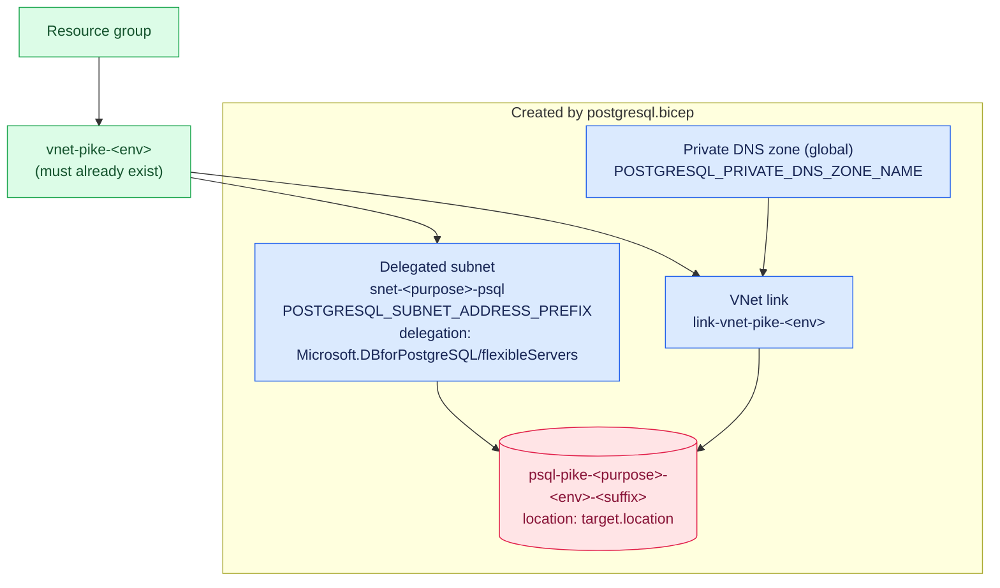

# 🐘 PostgreSQL Flexible Server module — `postgresql.bicep`

Creates an **Azure Database for PostgreSQL – Flexible Server** with **private access (VNet integration)**: a dedicated delegated subnet and a private DNS zone, and no public endpoint.

| | |
|---|---|
| **File** | [postgresql.bicep](postgresql.bicep) |
| **Azure resources** | `Microsoft.DBforPostgreSQL/flexibleServers@2023-06-01-preview`, `Microsoft.Network/virtualNetworks/subnets`, `Microsoft.Network/privateDnsZones`, `…/virtualNetworkLinks` |
| **Deployment scope** | Resource group |
| **`input.json` key** | `resourceTargets.postgresql` |
| **Server name** | `psql-pike-<purpose>-<env>-<suffix>` → e.g. `psql-pike-app-dev-` + 6 characters (FQDN `<name>.postgres.database.azure.com`). `<suffix>` = first 6 characters of `uniqueString(resourceGuid)`, where `resourceGuid` = `guid(<resource group ID>, 'Microsoft.DBforPostgreSQL/flexibleServers')` is the globally defined GUID declared in the module: unique across Azure, stable on re-runs in the same resource group. Microsoft limit: 3–63 characters, lowercase letters, digits and hyphens |

---

## What is PostgreSQL Flexible Server?

A managed PostgreSQL service. Azure handles patching, backups, high availability and scaling. The **Flexible Server** deployment model lets you choose the compute tier and size, the storage size and the HA mode, and supports **VNet integration**: the server gets a private IP inside a delegated subnet and is reachable only from the VNet (and peered networks).

---

## What the module creates and depends on



| Direction | Resource | Notes |
|---|---|---|
| **Needs** | VNet `vnet-pike-<env>` | The plan adds RG → VNet automatically. It does **not** need the main subnet `snet-<purpose>`. |
| **Creates** | Delegated subnet `snet-<purpose>-psql` | Must be **dedicated**: nothing else can be placed in a subnet delegated to PostgreSQL |
| **Creates** | Private DNS zone + VNet link | The server registers its private A record here, so clients in the VNet resolve the FQDN to the private IP |
| **Order inside the module** | subnet → DNS zone → VNet link → server | The server explicitly `dependsOn` the VNet link |
| **Secret** | `POSTGRESQL_ADMIN_PASSWORD` | `@secure()` |

---

## Parameters

| Parameter | Source | `dev` value | Description |
|---|---|---|---|
| `administratorLogin` | `POSTGRESQL_ADMIN_USERNAME` | `pikehexpgadmin` | Cannot be `azure_superuser`, `admin`, `root`, `postgres`, … |
| `administratorLoginPassword` | **secret** `POSTGRESQL_ADMIN_PASSWORD` | — | 8–128 chars, three of: upper, lower, digit, symbol |
| `version` | `POSTGRESQL_VERSION` | `15` | Allowed: `14`, `15`, `16` |
| `skuName` | `POSTGRESQL_SKU` | `Standard_D2ads_v5` | Compute size (must belong to `skuTier`) |
| `skuTier` | `POSTGRESQL_TIER` | `GeneralPurpose` | `Burstable`, `GeneralPurpose`, `MemoryOptimized` |
| `storageSizeGB` | `POSTGRESQL_STORAGE_SIZE_GB` | `32` | Minimum 32; must be one of the supported sizes (below) |
| `backupRetentionDays` | `POSTGRESQL_BACKUP_RETENTION_DAYS` | `7` | 7–35 |
| `geoRedundantBackup` | `POSTGRESQL_GEO_REDUNDANT_BACKUP` | `Disabled` | **Can only be chosen at creation** |
| `highAvailabilityMode` | `POSTGRESQL_HA_MODE` | `Disabled` | `Disabled`, `SameZone`, `ZoneRedundant` |
| `subnetAddressPrefix` | `POSTGRESQL_SUBNET_ADDRESS_PREFIX` | `10.40.3.0/28` | Free range inside the VNet |
| `privateDnsZoneName` | `POSTGRESQL_PRIVATE_DNS_ZONE_NAME` | `privatelink.postgres.database.azure.com` | |
| `environmentName`, `purpose`, `workload`, `location`, `tags` | `input.json` / `RESOURCE_TAGS` | | ⚠️ `location` is **not** used for the server (see below) |

## Outputs

| Output | Description |
|---|---|
| `deployedResourceId` / `deployedResourceName` | Server ID and name |
| `resourceGuid` | Globally defined GUID (`guid(<resource group ID>, <resource type>)`) the name suffix is derived from |
| `fullyQualifiedDomainName` | Server FQDN (resolves privately inside the VNet) |
| `delegatedSubnetId` | ID of `snet-<purpose>-psql` |
| `privateDnsZoneId` | ID of the private DNS zone |

---

## 📋 SKU details

### Compute tiers and example sizes

| Tier (`POSTGRESQL_TIER`) | Example `POSTGRESQL_SKU` values | vCores / RAM | Notes |
|---|---|---|---|
| `Burstable` | `Standard_B1ms`, `Standard_B2s`, `Standard_B2ms` | 1–2 / 2–8 GB | Cheapest; dev/test. **High availability is not supported.** |
| `GeneralPurpose` | `Standard_D2ds_v5`, **`Standard_D2ads_v5`** (current), `Standard_D4ds_v5`, `Standard_D2ds_v4`, `Standard_D2s_v3` | 2–4 / 8–16 GB | Most production workloads |
| `MemoryOptimized` | `Standard_E2ds_v5`, `Standard_E2ads_v5`, `Standard_E4ds_v5` | 2–4 / 16–32 GB | Memory-heavy workloads |

`skuName` must belong to `skuTier`. For example, `Standard_B2s` with `GeneralPurpose` fails.

### Storage sizes (`POSTGRESQL_STORAGE_SIZE_GB`)

Only these values are accepted: **32, 64, 128, 256, 512, 1024, 2048, 4096, 8192, 16384, 32768** GB. Storage can be **increased** later but **never decreased**.

### Other settings

| Setting | Rule |
|---|---|
| High availability (`SameZone`, `ZoneRedundant`) | Not on `Burstable`. `ZoneRedundant` needs a region with availability zones *and* zone capacity for the chosen SKU. HA roughly doubles the compute cost. |
| Geo-redundant backup | Set at creation only; needs a region that has a paired region |
| Delegated subnet size | `/28` (16 addresses) is the minimum that works. Microsoft recommends larger subnets if you plan HA, scaling or read replicas. |

---

## ⚠️ Known issues

### 1. SKUs not available in `eastus`

The team hit **PostgreSQL deployment failures in `eastus`**: most compute SKUs, and the storage options with them, were not available to the subscription in that region. PostgreSQL Flexible Server capacity is restricted per subscription and region, and `eastus` is frequently restricted for new deployments.

| Error you may see | Meaning | What to do |
|---|---|---|
| `LocationIsOfferRestricted` — *"Subscriptions are restricted from provisioning in location 'eastus'. Try again in a different location."* | New PostgreSQL servers are blocked for this subscription in the region | Use another region, or open a quota/region-access request with Microsoft support |
| SKU / tier not available | The chosen `skuName` is not offered in the region (or not in the zone) | Pick a SKU from `list-skus` output (below) |
| HA / zone errors | No zone capacity for the SKU | Use `HA_MODE=Disabled` or `SameZone`, or another region |

### 2. Region

The server is deployed in `target.location` (`location: location`), the same region as the VNet and the delegated subnet. VNet-integrated private access requires that.

### 3. ✅ Automatic check at deploy time

The pipeline checks PostgreSQL availability **while it runs**, against the subscription of the selected GitHub Environment. It does this in the *SKU selection* step of the `deploy` job ([.github/scripts/select-skus.js](../../.github/scripts/select-skus.js)), before the server is deployed:

| `POSTGRESQL_SKU` | Result |
|---|---|
| empty or `auto` | The lowest-cost SKU available to the subscription in `target.location`: lowest tier first (Burstable → GeneralPurpose → MemoryOptimized), then fewest vCores. `POSTGRESQL_TIER` is set to match. Burstable is skipped if `POSTGRESQL_HA_MODE` is not `Disabled` |
| explicit (e.g. `Standard_D2ads_v5`) | Checked. If it is not available, the entry fails **before deployment** and the error lists the cheapest available alternatives |

The same step checks that `POSTGRESQL_VERSION` and `POSTGRESQL_STORAGE_SIZE_GB` are offered in the region. If the region is restricted for the subscription (`LocationIsOfferRestricted`), the entry fails with that message instead of failing halfway through a deployment. The decision is shown in the run summary under *SKU selection*.

To check by hand (read-only):

```bash
az postgres flexible-server list-skus --location eastus -o json
```
