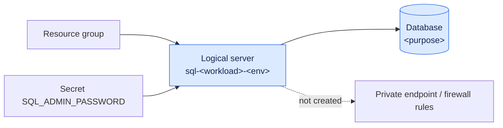

# 🗃️ Azure SQL module — `sql.bicep`

Creates an **Azure SQL logical server** and **one Azure SQL Database** on it.

| | |
|---|---|
| **File** | [sql.bicep](sql.bicep) |
| **Azure resources** | `Microsoft.Sql/servers@2021-11-01`, `Microsoft.Sql/servers/databases@2021-11-01` |
| **Deployment scope** | Resource group |
| **`input.json` key** | `resourceTargets.sqlDatabase` |
| **Server name** | `sql-<workload>-<env>-<suffix>` → e.g. `sql-platform-svc-dev-` + 6 characters (FQDN `<name>.database.windows.net`). `<suffix>` = first 6 characters of `uniqueString(<resource group ID>)`: unique across Azure, stable on re-runs in the same resource group. Microsoft limit: 1–63 characters, lowercase letters, digits and hyphens |
| **Database name** | `<purpose>` → e.g. `app` |

> This is the **PaaS** Azure SQL Database. For SQL Server on a VM, use `vmWindowsSql` (see [compute/README.md](../compute/README.md)).

---

## What is Azure SQL Database?

A fully managed SQL Server database engine. The **logical server** is a management endpoint (logins, firewall, network settings) and holds no data itself. The **database** has its own compute and storage SKU. Several databases can share one server.

---

## Dependencies



| Direction | Resource | Notes |
|---|---|---|
| **Needs** | Resource group | No VNet or subnet dependency |
| **Creates** | Server, then database | The database is a child (`parent: sqlServer`) |
| **Not created** | Firewall rules, private endpoint, Entra admin, auditing | See *Connectivity* below |
| **Secret** | `SQL_ADMIN_PASSWORD` | SQL authentication admin password (`@secure()`) |

---

## Parameters

| Parameter | Source | `dev` value | Description |
|---|---|---|---|
| `administratorLogin` | `AZURE_SQL_ADMIN_USERNAME` | `pikehexsqladmin` | Cannot be `admin`, `sa`, `root`, … |
| `administratorLoginPassword` | **secret** `SQL_ADMIN_PASSWORD` | — | |
| `sqlServerVersion` | `AZURE_SQL_VERSION` | `12.0` | The only current version value |
| `databaseSkuName` | `AZURE_SQL_SKU` | `Basic` | See SKU table |
| `databaseSkuTier` | `AZURE_SQL_TIER` | `Basic` | Must match the SKU name |
| `databaseCapacity` | `AZURE_SQL_CAPACITY` | `5` | DTUs (DTU model) or vCores (vCore model) |
| `databaseMaxSizeGB` | `AZURE_SQL_MAX_SIZE_GB` | `2` | Converted to bytes; must be allowed for the SKU |
| `publicNetworkAccess` | `AZURE_SQL_PUBLIC_NETWORK_ACCESS` | `Disabled` | `Enabled` / `Disabled` |
| `minimumTlsVersion` | `AZURE_SQL_MIN_TLS_VERSION` | `1.2` | |
| `environmentName`, `workload`, `purpose`, `location`, `tags` | `input.json` / `RESOURCE_TAGS` | | |

## Outputs

| Output | Description |
|---|---|
| `deployedResourceId` / `deployedResourceName` | Logical server ID and name |
| `sqlDatabaseId` / `sqlDatabaseName` | Database ID and name |

---

## 📋 SKU details

The SKU name, tier and capacity must form a valid combination:

| Model | `AZURE_SQL_SKU` | `AZURE_SQL_TIER` | `AZURE_SQL_CAPACITY` | Max size (`AZURE_SQL_MAX_SIZE_GB`) | Use |
|---|---|---|---|---|---|
| DTU | **`Basic`** (current) | `Basic` | `5` | up to **2 GB** | Small dev/test |
| DTU | `S0` … `S12` | `Standard` | `10` … `3000` | up to 250 GB (1 TB on S3+) | General dev/test, light production |
| DTU | `P1` … `P15` | `Premium` | `125` … `4000` | up to 1–4 TB | IO-heavy |
| vCore | `GP_Gen5` | `GeneralPurpose` | `2`, `4`, `8`, … (vCores) | up to 4 TB | Most production |
| vCore serverless | `GP_S_Gen5` | `GeneralPurpose` | `1`, `2`, `4`, … (max vCores) | up to 4 TB | Auto-pause and auto-scale dev/test |
| vCore | `BC_Gen5` | `BusinessCritical` | `2`, `4`, … | up to 4 TB | Low latency, built-in HA |
| vCore | `HS_Gen5` | `Hyperscale` | `2`, `4`, … | up to 100 TB | Very large databases |

> With the current `Basic` SKU, `AZURE_SQL_MAX_SIZE_GB` cannot exceed **2**.
> ⚠️ The module does not set serverless options (auto-pause delay, min vCores), so `GP_S_Gen5` uses the Azure defaults.

---

## Connectivity

With `AZURE_SQL_PUBLIC_NETWORK_ACCESS = Disabled` (the current `dev` value) and **no private endpoint** (this module creates none), the database is **not reachable from any network** until a private endpoint is added. Either:

- add a private endpoint into `vnet-pike-<env>` (not available as a module in this repository), or
- set public access to `Enabled` and add firewall rules (not created by this module), following the `PUBLIC_ACCESS` policy.

---

## Naming notes

- The server name is **globally unique** (it is a DNS name). The 6-character `uniqueString` suffix prevents `NameAlreadyExists` when another tenant already uses `sql-<workload>-<env>`. Because of the suffix, `target.workload` can be at most 47 characters; the `plan` job checks this.
- A deleted logical server name may stay reserved for a short time.

## Checking region availability

Region capacity for Azure SQL also varies by subscription. Before deploying in a new region:

```bash
# Editions, SKUs and capacities offered in the region
az sql db list-editions --location eastus --available -o table

# Server-level quota in the region
az sql list-usages --location eastus -o table
```

A `RegionDoesNotAllowProvisioning` error means that the subscription cannot create SQL servers in that region.
