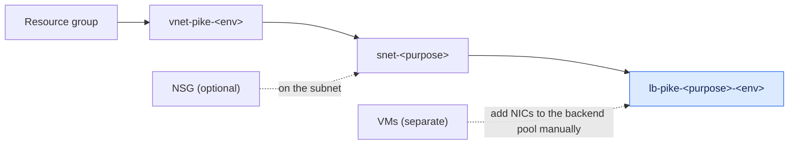

# ⚖️ Load Balancer module — `lb.bicep`

Creates an **internal Standard Load Balancer** (Layer 4, TCP/UDP) whose private frontend IPs sit in the main workload subnet.

| | |
|---|---|
| **File** | [lb.bicep](lb.bicep) |
| **Azure resource** | `Microsoft.Network/loadBalancers@2023-09-01` |
| **Deployment scope** | Resource group |
| **`input.json` key** | `resourceTargets.loadBalancer` |
| **Name** | `lb-pike-<purpose>-<env>` → e.g. `lb-pike-app-dev` |

---

## What is a Standard Load Balancer?

It spreads TCP/UDP traffic across a backend pool (VMs or IPs) using a hash of source and destination. Health probes take unhealthy members out of rotation. Use it for non-HTTP traffic, or for HTTP that needs no Layer-7 features. For HTTP routing, TLS termination or WAF, use the Application Gateway (`agw`) instead.

---

## Dependencies

| Direction | Resource | Notes |
|---|---|---|
| **Needs** | Subnet `snet-<purpose>` in `vnet-pike-<env>` | Added to the plan automatically: RG → VNet → Subnet → LB |
| **Does not create** | Public IP | The frontend is private only (static IP in the subnet) |
| **Does not link** | VMs | Backend pools are created empty (`addresses` is not used by the module). VM NICs must be added to the pool separately. |

---

## Parameters

| Parameter | Source | Description |
|---|---|---|
| `environmentName`, `workload`, `purpose`, `location` | `input.json` | Name, tags, subnet lookup, region |
| `skuName` | `LOAD_BALANCER_SKU` | Only `Standard` is allowed |
| `skuTier` | `LOAD_BALANCER_TIER` | Only `Regional` is allowed |
| `frontends` | `LOAD_BALANCER_FRONTENDS` | `[{ name, privateIp }]`; `privateIp` must be a free address inside `SUBNET_ADDRESS_PREFIX` (e.g. `10.40.1.10`) |
| `backendPools` | `LOAD_BALANCER_BACKEND_POOLS` | `[{ name }]` |
| `probes` | `LOAD_BALANCER_PROBES` | `[{ name, protocol, port, intervalInSeconds, numberOfProbes }]` |
| `loadBalancingRules` | `LOAD_BALANCER_RULES` | `[{ name, frontendName, backendPoolName, probeName, protocol, frontendPort, backendPort, idleTimeoutInMinutes, enableFloatingIp, enableTcpReset }]`; the names must match the frontends, pools and probes above |
| `tags` | `RESOURCE_TAGS` | |

Current `dev` values are in [docs/github-environment-variables.md](../../docs/github-environment-variables.md).

## Outputs

| Output | Description |
|---|---|
| `deployedResourceId` | Load balancer resource ID |
| `deployedResourceName` | `lb-pike-<purpose>-<env>` |

---

## SKU notes

| Setting | Value | Notes |
|---|---|---|
| SKU | `Standard` | The Basic SKU is retired by Azure and is not allowed by the module |
| Tier | `Regional` | Global (cross-region) tier is not supported by this module |
