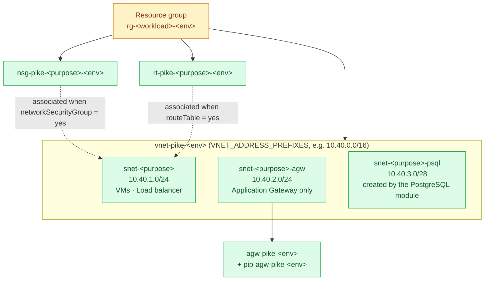

# 🌐 Networking modules

This directory contains the six networking modules. Together they build the private network that VMs, the load balancer, the application gateway and PostgreSQL are placed into.

| Module | Azure resource | `input.json` key | Name |
|---|---|---|---|
| [vnet.bicep](vnet.bicep) | Virtual network | `virtualNetwork` | `vnet-pike-<env>` |
| [subnet.bicep](subnet.bicep) | Subnet (main workload subnet) | `subnet` | `snet-<purpose>` |
| [nsg.bicep](nsg.bicep) | Network security group | `networkSecurityGroup` | `nsg-pike-<purpose>-<env>` |
| [routetable.bicep](routetable.bicep) | Route table | `routeTable` | `rt-pike-<purpose>-<env>` |
| [applicationGatewaySubnet.bicep](applicationGatewaySubnet.bicep) | Dedicated Application Gateway subnet | `applicationGatewaySubnet` | `snet-<purpose>-agw` |
| [applicationGateway.bicep](applicationGateway.bicep) | Application Gateway (Layer 7) + public IP | `applicationGateway` | `agw-pike-<env>`, `pip-agw-pike-<env>` |

All six deploy at **resource-group** scope into `rg-<workload>-<env>`.

---

## How the pieces fit together

Deployment order inside a plan: **RG → NSG → Route table → VNet → Subnet → App Gateway subnet → … → Application Gateway**.

---

## 1. Virtual network — `vnet.bicep`

**What it is:** the private address space (for example `10.40.0.0/16`) that the subnets are carved out of. Resources in the same VNet can reach each other privately.

| Dependency | |
|---|---|
| Needs | Resource group |
| Needed by | Subnet, App Gateway subnet, PostgreSQL (all look the VNet up by the name `vnet-pike-<env>`) |

| Parameter | Source | Description |
|---|---|---|
| `environmentName`, `workload`, `location` | `input.json` | Name, tags, region |
| `addressPrefixes` | `VNET_ADDRESS_PREFIXES` | JSON array, e.g. `["10.40.0.0/16"]` |
| `dnsServers` | `VNET_DNS_SERVERS` | JSON array; `[]` = Azure-provided DNS |
| `tags` | `RESOURCE_TAGS` | |

> ⚠️ **Never re-applied when it exists.** The template declares `subnets: []`. Re-deploying it would **delete** every subnet created later by the subnet, App Gateway subnet and PostgreSQL modules. The workflow therefore skips this module (status `Skipped`) whenever What-If shows that the VNet already exists, even when `virtualNetwork` is `yes`. To change the address space of an existing VNet, do it outside this workflow.

There is one VNet per environment (`vnet-pike-<env>`), shared by all workloads that deploy into the same subscription and resource group.

---

## 2. Subnet — `subnet.bicep`

**What it is:** the main workload subnet `snet-<purpose>` inside `vnet-pike-<env>`. VM network interfaces and the load-balancer frontend are placed here.

| Dependency | |
|---|---|
| Needs | VNet `vnet-pike-<env>` (must exist) |
| Optional | NSG `nsg-pike-<purpose>-<env>` and route table `rt-pike-<purpose>-<env>`: associated **only** when they are `yes` in `input.json`, and then deployed **before** the subnet |
| Needed by | VMs (Windows / Linux / Windows-SQL), Load balancer |

| Parameter | Source | Description |
|---|---|---|
| `environmentName`, `purpose` | `input.json` | Locate the VNet and build the subnet name |
| `addressPrefix` | `SUBNET_ADDRESS_PREFIX` | e.g. `10.40.1.0/24` (must be inside the VNet range) |
| `attachNetworkSecurityGroup` | computed: `networkSecurityGroup == yes` | Associates the NSG |
| `attachRouteTable` | computed: `routeTable == yes` | Associates the route table |
| `serviceEndpoints` | `SUBNET_SERVICE_ENDPOINTS` | JSON array |
| `privateEndpointNetworkPolicies` | `SUBNET_PRIVATE_ENDPOINT_NETWORK_POLICIES` | `Enabled`, `Disabled`, `NetworkSecurityGroupEnabled`, `RouteTableEnabled` |
| `privateLinkServiceNetworkPolicies` | `SUBNET_PRIVATE_LINK_SERVICE_NETWORK_POLICIES` | `Enabled`, `Disabled` |

> ℹ️ VMs have **no NSG on their NIC**. Network filtering for VMs comes from the NSG on this subnet, so set `networkSecurityGroup: "yes"` if the VMs need one.

---

## 3. Network security group — `nsg.bicep`

**What it is:** a stateful firewall rule set (allow/deny by source, destination, port and protocol) applied to the subnet.

| Dependency | |
|---|---|
| Needs | Resource group |
| Used by | Subnet (association, when both are `yes`) |

| Parameter | Source | Description |
|---|---|---|
| `environmentName`, `workload`, `purpose`, `location` | `input.json` | Name, tags, region |
| `securityRules` | `NSG_SECURITY_RULES` | JSON array of `{ name, protocol, sourcePortRange, destinationPortRange, sourceAddressPrefix, destinationAddressPrefix, access, priority, direction, description? }` |
| `tags` | `RESOURCE_TAGS` | |

With `NSG_SECURITY_RULES = []`, only the Azure default rules apply: VNet-to-VNet and the Azure load balancer are allowed, and all other inbound traffic is denied.

---

## 4. Route table — `routetable.bicep`

**What it is:** user-defined routes (UDRs) that override Azure's default routing for the subnet, for example to send traffic through a firewall.

| Dependency | |
|---|---|
| Needs | Resource group |
| Used by | Subnet (association, when both are `yes`) |

| Parameter | Source | Description |
|---|---|---|
| `environmentName`, `workload`, `purpose`, `location` | `input.json` | Name, tags, region |
| `routes` | `ROUTE_TABLE_ROUTES` | JSON array of `{ name, addressPrefix, nextHopType, nextHopIpAddress? }` |
| `disableBgpRoutePropagation` | `ROUTE_TABLE_DISABLE_BGP_PROPAGATION` | `true` / `false` |
| `tags` | `RESOURCE_TAGS` | |

---

## 5. Application Gateway subnet — `applicationGatewaySubnet.bicep`

**What it is:** a subnet reserved for the Application Gateway. Azure requires the gateway to have a subnet of its own, which may contain only Application Gateways. The `-agw` suffix keeps it separate from the main subnet.

| Dependency | |
|---|---|
| Needs | VNet `vnet-pike-<env>` |
| Needed by | Application Gateway |

| Parameter | Source | Description |
|---|---|---|
| `environmentName`, `purpose` | `input.json` | Locate the VNet and build the name |
| `subnetAddressPrefix` | `APP_GATEWAY_SUBNET_ADDRESS_PREFIX` | e.g. `10.40.2.0/24` (Microsoft recommends `/24` for v2) |

---

## 6. Application Gateway — `applicationGateway.bicep`

**What it is:** a Layer-7 (HTTP/HTTPS) load balancer with listeners, routing rules, health probes and an optional WAF. The module creates both a **public** frontend (on a new Standard static public IP) and a **private** frontend (a static IP in the gateway subnet).

| Dependency | |
|---|---|
| Needs | App Gateway subnet `snet-<purpose>-agw` → VNet → RG |
| Creates | Public IP `pip-agw-pike-<env>` (Standard, static, IPv4) |

| Parameter | Source | Description |
|---|---|---|
| `skuName` | `APP_GATEWAY_SKU` | `Standard_v2` or `WAF_v2` (also used as the tier) |
| `privateFrontendIp` | `APP_GATEWAY_PRIVATE_FRONTEND_IP` | Static IP inside the gateway subnet, e.g. `10.40.2.10` |
| `minCapacity` / `maxCapacity` | `APP_GATEWAY_MIN_CAPACITY` / `APP_GATEWAY_MAX_CAPACITY` | Autoscale range (0–125 / 2–125) |
| `enableHttp2` | `APP_GATEWAY_ENABLE_HTTP2` | |
| `frontendPorts` | `APP_GATEWAY_FRONTEND_PORTS` | `[{ name, port }]` |
| `backendPools` | `APP_GATEWAY_BACKEND_POOLS` | `[{ name, backendAddresses }]` |
| `healthProbes` | `APP_GATEWAY_HEALTH_PROBES` | `[{ name, protocol, host, path, interval, timeout, unhealthyThreshold, statusCodes }]` |
| `backendHttpSettings` | `APP_GATEWAY_BACKEND_HTTP_SETTINGS` | `[{ name, port, protocol, requestTimeout, cookieBasedAffinity, probeName }]` |
| `listeners` | `APP_GATEWAY_LISTENERS` | `frontendIPConfigurationName` must be `frontend-public` or `frontend-private` |
| `routingRules` | `APP_GATEWAY_ROUTING_RULES` | `[{ name, priority, listenerName, backendPoolName, httpSettingName }]` (Basic rules) |

Outputs include `publicIpAddress`.

> ⚠️ The gateway always gets a **public** IP, even when only private listeners are used. Check this against the `PUBLIC_ACCESS` policy before enabling it in `qa`/`uat`/`prod`.

---

## Common outputs

Every module returns `deployedResourceId` and `deployedResourceName`. The workflow writes both to the inventory CSV, with the subscription ID redacted.
