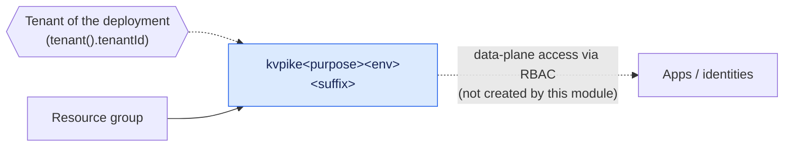

# 🔑 Key Vault module — `keyvault.bicep`

Creates an **Azure Key Vault** for storing secrets, keys and certificates.

| | |
|---|---|
| **File** | [keyvault.bicep](keyvault.bicep) |
| **Azure resource** | `Microsoft.KeyVault/vaults@2023-07-01` |
| **Deployment scope** | Resource group |
| **`input.json` key** | `resourceTargets.keyVault` |
| **Name** | `kvpike<purpose><env><suffix>` → e.g. `kvpikeappdev` + 6 characters (all lowercase, no hyphens, max 24). See [Naming rules](#naming-rules) |

---

## What is Key Vault?

Key Vault is a managed store for secrets (passwords, connection strings), cryptographic keys and certificates. Applications read from it through Microsoft Entra authentication, so secrets do not have to live in code or configuration.

---

## Dependencies

| Direction | Resource | Notes |
|---|---|---|
| **Needs** | Resource group | No network dependency |
| **Uses** | Entra tenant | `tenantId` defaults to the tenant of the deployment |
| **Not created** | Role assignments / access policies, private endpoint | With `enableRbacAuthorization: true`, nobody can read secrets until a data-plane role such as *Key Vault Secrets User* is assigned |

---

## Naming rules

| Rule | Microsoft limit (`Microsoft.KeyVault/vaults`) | Pike name |
|---|---|---|
| Uniqueness | **Global** (the name becomes `https://<name>.vault.azure.net`) | ✅ unique suffix |
| Length | **3–24** characters | ✅ always 13–24 |
| Characters | Alphanumerics and hyphens · start with a letter · end with a letter or digit · no consecutive hyphens | ✅ starts with `k`, letters/digits only |
| Pike convention | All **lowercase**, **no spaces**, **no hyphens** | ✅ |

The name is `kvpike` + `purpose` + `env` + a suffix, where `<suffix>` = first characters of `uniqueString(resourceGuid)`, where `resourceGuid` = `guid(<resource group ID>, 'Microsoft.KeyVault/vaults')` is the globally defined GUID declared in the module:

| Part | Length |
|---|---|
| `kvpike` | 6 |
| `purpose` (validated by the pipeline: 2–11 lowercase letters/digits) | 2–11 |
| `env` (`dev`, `qa`, `uat`, `prod`) | 2–4 |
| Suffix: **6** characters, shortened only when needed to stay at 24 (never fewer than 3) | 3–6 |
| **Total** | **13–24** |

- **Unique:** the suffix differs for every subscription and resource group, so two environments or two clients can never collide on the global name.
- **Stable:** the suffix is deterministic. Re-running the workflow in the same resource group produces the same name and updates the existing vault instead of creating a second one.
- **Always valid:** the module lower-cases the name and strips spaces, `-`, `_` and `.`.

The exact name is printed in the run summary and in the inventory CSV (`deployedResourceName`).

> ⚠️ **Soft delete and purge protection:** a deleted vault keeps its name reserved for the retention period. With purge protection on, the vault **cannot be purged** early. Re-creating the same name during that period fails until the soft-deleted vault is recovered or the period ends.

---

## Parameters

| Parameter | Source | `dev` value | Description |
|---|---|---|---|
| `skuName` | `KEY_VAULT_SKU` | `standard` | `standard` or `premium` (HSM-backed keys) |
| `skuFamily` | `KEY_VAULT_SKU_FAMILY` | `A` | Only `A` |
| `enableRbacAuthorization` | `KEY_VAULT_RBAC_AUTHORIZATION` | `true` | Use Azure RBAC instead of access policies |
| `enablePurgeProtection` | `KEY_VAULT_PURGE_PROTECTION` | `true` | Cannot be turned off once enabled |
| `softDeleteRetentionInDays` | `KEY_VAULT_SOFT_DELETE_RETENTION_DAYS` | `7` | 7–90; cannot be changed after creation |
| `publicNetworkAccess` | `KEY_VAULT_PUBLIC_NETWORK_ACCESS` | `Enabled` | `Enabled` / `Disabled` |
| `tenantId` | default `tenant().tenantId` | | |
| `environmentName`, `workload`, `purpose`, `location`, `tags` | `input.json` / `RESOURCE_TAGS` | | |

## Outputs

| Output | Description |
|---|---|
| `deployedResourceId` | Vault resource ID |
| `deployedResourceName` | `kvpike<purpose><env><suffix>` |
| `resourceGuid` | Globally defined GUID (`guid(<resource group ID>, <resource type>)`) the name suffix is derived from |

---

## SKU notes

| SKU | Use |
|---|---|
| `standard` | Software-protected keys, secrets and certificates. This is the default. |
| `premium` | Adds HSM-protected keys. Costs more per key operation. |
