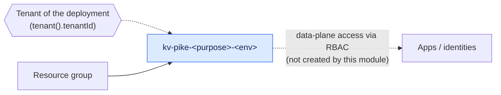

# 🔑 Key Vault module — `keyvault.bicep`

Creates an **Azure Key Vault** for storing secrets, keys and certificates.

| | |
|---|---|
| **File** | [keyvault.bicep](keyvault.bicep) |
| **Azure resource** | `Microsoft.KeyVault/vaults@2023-07-01` |
| **Deployment scope** | Resource group |
| **`input.json` key** | `resourceTargets.keyVault` |
| **Name** | `kv-pike-<purpose>-<env>` → e.g. `kv-pike-app-dev` |

---

## What is Key Vault?

Key Vault is a managed store for secrets (passwords, connection strings), cryptographic keys and certificates. Applications read from it through Microsoft Entra authentication, so secrets do not have to live in code or configuration.

---

## Dependencies

| Direction | Resource | Notes |
|---|---|---|
| **Needs** | Resource group | No network dependency |
| **Uses** | Entra tenant | `tenantId` defaults to the tenant of the deployment |
| **Not created** | Role assignments / access policies, private endpoint | With `enableRbacAuthorization: true`, nobody can read secrets until a data-plane role such as *Key Vault Secrets User* is assigned |

---

## Naming rules

Vault names must be **3–24 characters, globally unique** (they become `https://<name>.vault.azure.net`).
Length budget: `kv-pike-` (8) + purpose (≤ 11) + `-` (1) + env (≤ 4) = at most 24 characters. This is why `target.purpose` is limited to 11 characters.

> ⚠️ **Soft delete and purge protection:** a deleted vault keeps its name reserved for the retention period. With purge protection on, the vault **cannot be purged** early. Re-creating the same name during that period fails until the soft-deleted vault is recovered or the period ends.

---

## Parameters

| Parameter | Source | `dev` value | Description |
|---|---|---|---|
| `skuName` | `KEY_VAULT_SKU` | `standard` | `standard` or `premium` (HSM-backed keys) |
| `skuFamily` | `KEY_VAULT_SKU_FAMILY` | `A` | Only `A` |
| `enableRbacAuthorization` | `KEY_VAULT_RBAC_AUTHORIZATION` | `true` | Use Azure RBAC instead of access policies |
| `enablePurgeProtection` | `KEY_VAULT_PURGE_PROTECTION` | `true` | Cannot be turned off once enabled |
| `softDeleteRetentionInDays` | `KEY_VAULT_SOFT_DELETE_RETENTION_DAYS` | `7` | 7–90; cannot be changed after creation |
| `publicNetworkAccess` | `KEY_VAULT_PUBLIC_NETWORK_ACCESS` | `Enabled` | `Enabled` / `Disabled` |
| `tenantId` | default `tenant().tenantId` | | |
| `environmentName`, `workload`, `purpose`, `location`, `tags` | `input.json` / `RESOURCE_TAGS` | | |

## Outputs

| Output | Description |
|---|---|
| `deployedResourceId` | Vault resource ID |
| `deployedResourceName` | `kv-pike-<purpose>-<env>` |

---

## SKU notes

| SKU | Use |
|---|---|
| `standard` | Software-protected keys, secrets and certificates. This is the default. |
| `premium` | Adds HSM-protected keys. Costs more per key operation. |
