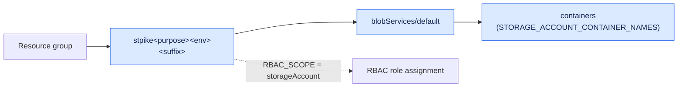

# 🗄️ Storage Account module — `storageAccount.bicep`

Creates a **general-purpose Storage Account** with its blob service and a list of blob containers.

| | |
|---|---|
| **File** | [storageAccount.bicep](storageAccount.bicep) |
| **Azure resources** | `Microsoft.Storage/storageAccounts`, `…/blobServices`, `…/blobServices/containers` (`@2023-05-01`) |
| **Deployment scope** | Resource group |
| **`input.json` key** | `resourceTargets.storageAccount` |
| **Name** | `stpike<purpose><env><suffix>` → e.g. `stpikeappdev` + 6 characters (all lowercase, no hyphens, max 24). See [Naming rules](#naming-rules) |

---

## What is a Storage Account?

It is a container for Azure Storage data services: blobs, files, queues and tables. This module enables the **blob** service and creates the containers listed in `STORAGE_ACCOUNT_CONTAINER_NAMES`.

---

## Dependencies

| Direction | Resource | Notes |
|---|---|---|
| **Needs** | Resource group | No network dependency; public network access is controlled by a variable |
| **Needed by** | RBAC with `RBAC_SCOPE=storageAccount` | `RBAC_resource.bicep` looks the account up by `RBAC_STORAGE_ACCOUNT_NAME`. Set it to the full name, including the suffix, from the run summary |

---

## Naming rules

| Rule | Microsoft limit (`Microsoft.Storage/storageAccounts`) | Pike name |
|---|---|---|
| Uniqueness | **Unique across all of Azure** (the name becomes `https://<name>.blob.core.windows.net`) | ✅ unique suffix |
| Length | **3–24** characters | ✅ always 13–24 |
| Characters | **Lowercase letters and numbers only**: no spaces, no hyphens, no underscores, no periods | ✅ |

The name is `stpike` + `purpose` + `env` + a suffix, where `<suffix>` = first characters of `uniqueString(resourceGuid)`, where `resourceGuid` = `guid(<resource group ID>, 'Microsoft.Storage/storageAccounts')` is the globally defined GUID declared in the module:

| Part | Length |
|---|---|
| `stpike` | 6 |
| `purpose` (validated by the pipeline: 2–11 lowercase letters/digits) | 2–11 |
| `env` (`dev`, `qa`, `uat`, `prod`) | 2–4 |
| Suffix: **6** characters, shortened only when needed to stay at 24 (never fewer than 3) | 3–6 |
| **Total** | **13–24** |

- **Unique:** the suffix differs for every subscription and resource group, so the deployment does not fail with `StorageAccountAlreadyTaken` because someone else already owns `stpikeappdev`.
- **Stable:** the suffix is deterministic. Re-running the workflow in the same resource group produces the same name and updates the existing account.
- **Always valid:** the module removes spaces, `-`, `_` and `.` and lower-cases the result, so a non-compliant name can never be produced.

The exact name is printed in the run summary and in the inventory CSV (`deployedResourceName`). Use that value for `RBAC_STORAGE_ACCOUNT_NAME` when `RBAC_SCOPE=storageAccount`.

---

## Parameters

| Parameter | Source | `dev` value | Description |
|---|---|---|---|
| `skuName` | `STORAGE_ACCOUNT_SKU` | `Standard_LRS` | Redundancy: `Standard_LRS`, `Standard_ZRS`, `Standard_GRS`, `Standard_RAGRS`, `Premium_LRS`, … |
| `kind` | `STORAGE_ACCOUNT_KIND` | `StorageV2` | |
| `accessTier` | `STORAGE_ACCOUNT_ACCESS_TIER` | `Hot` | `Hot` / `Cool` |
| `minimumTlsVersion` | `STORAGE_ACCOUNT_MIN_TLS_VERSION` | `TLS1_2` | |
| `supportsHttpsTrafficOnly` | `STORAGE_ACCOUNT_HTTPS_ONLY` | `true` | |
| `allowBlobPublicAccess` | `STORAGE_ACCOUNT_ALLOW_BLOB_PUBLIC_ACCESS` | `false` | |
| `allowSharedKeyAccess` | `STORAGE_ACCOUNT_ALLOW_SHARED_KEY_ACCESS` | `true` | |
| `publicNetworkAccess` | `STORAGE_ACCOUNT_PUBLIC_NETWORK_ACCESS` | `Enabled` | `Enabled` / `Disabled` |
| `containerNames` | `STORAGE_ACCOUNT_CONTAINER_NAMES` | `["appdata"]` | JSON array |
| `blobServiceName` | `STORAGE_ACCOUNT_BLOB_SERVICE_NAME` | `default` | Must be `default` |
| `containerPublicAccess` | `STORAGE_ACCOUNT_CONTAINER_PUBLIC_ACCESS` | `None` | `None` / `Blob` / `Container` |
| `environmentName`, `workload`, `purpose`, `location`, `tags` | `input.json` / `RESOURCE_TAGS` | | |

## Outputs

| Output | Description |
|---|---|
| `deployedResourceId` | Storage account resource ID |
| `deployedResourceName` | Final account name |
| `resourceGuid` | Globally defined GUID (`guid(<resource group ID>, <resource type>)`) the name suffix is derived from |
| `containerNamesOut` | The containers that were created |

---

## Notes

- Blob soft delete is **disabled** (`deleteRetentionPolicy.enabled: false`).
- A Data Lake Gen2 account (hierarchical namespace) is **not** supported by this module.
- Changing `skuName` between some redundancy types (for example to or from `Premium_LRS`) is not an in-place update in Azure.
